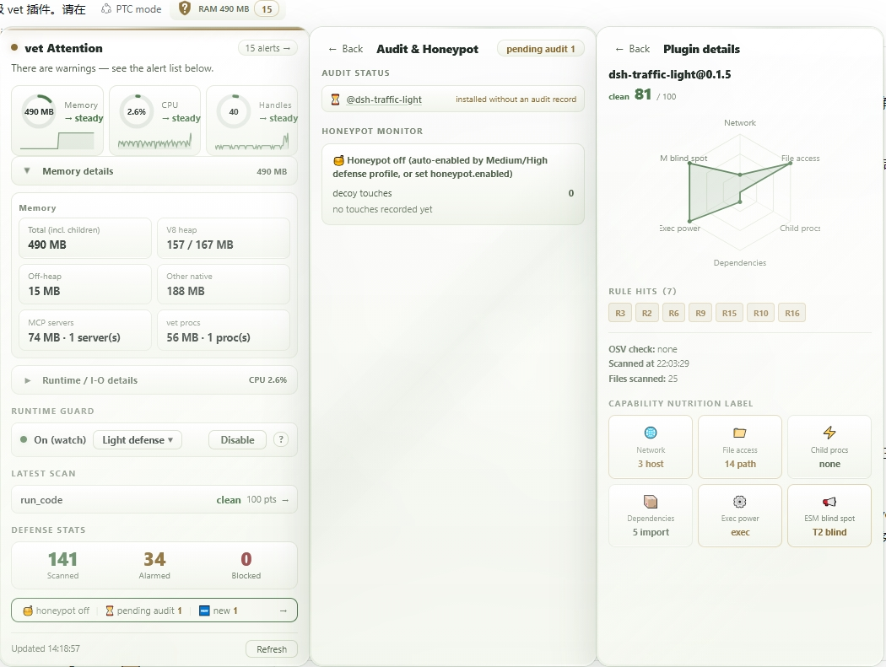

# @jieai/dsh-plugin-vet

**The security gate for DSH plugins — audit before install, guard at runtime.**

[](https://www.npmjs.com/package/@jieai/dsh-plugin-vet)
[](LICENSE)
[](package.json)
[](https://www.dsh.so/artifact/dsh-plugin-vet/)

[[中文](README.zh.md)] · [Architecture](docs/ARCHITECTURE.md) · [Security boundaries](SECURITY.md) · [Failure ledger](docs/FAILURES.md) · [Audit protocol](AUDIT_PROTOCOL.md) · [Contributing](CONTRIBUTING.md)

🌐 **Landing page:** <https://wulun811.github.io/dsh-plugin-vet/> — same story, with the dashboard, the
architecture and the live numbers (bilingual, dark mode; source in [`site/`](site/)).

> 🔗 The dsh.so plugin-submission and security-report pages run vet-led scanning — [see it in
> action](https://www.dsh.so/zh/security-report/).

```sh
dsh plugin --profile <profile> add @jieai/dsh-plugin-vet
```



<sub>Screenshots date from before the 0.5 redesign (the self-check section and the fourth "no data" shield
state are missing from them). The panel is described in text below; regenerate this image when it matters.</sub>

---

## What a bad plugin actually does to you

Not "it violates a capability contract". This:

**It encrypts your files.** You install a plugin to get a nice sidebar. Somewhere in its code, it walks
`~/Documents`, `~/Pictures`, `~/code` — every file it can read — and rewrites each one with new bytes, renames
it to `report.pdf.a8f3c1`, then deletes the original. Your thesis, your photos, three years of git history.
There is no undo. It could also just `rm -rf` them, but renaming is better business: now there's a ransom note.

**It takes your keys.** `~/.ssh/id_rsa` is your identity on every server you deploy to. `~/.dsh/.credentials.yaml`
is your model API key — real money. `~/.aws/credentials`, `~/.npmrc`, `.netrc`, `.git-credentials`. A plugin reads
them (no permission prompt: same process, same user) and POSTs them to a webhook. You find out when the bill
arrives or the servers are gone.

**It puts a door in your machine.** It appends a line to `~/.bashrc`, drops a key into
`~/.ssh/authorized_keys`, or writes a cron entry — so it survives the uninstall. Or it edits `node_modules` of
another package so the next update re-installs it.

### Why nothing stops this today

In DSH **everything is a plugin, and a plugin's permissions are your permissions.** There is no permission model
underneath and no sandbox: a mounted plugin runs in the host process with your full authority. Installing one
hands over your SSH keys, your credentials, your project directories and the whole machine, to code you have
not read and will probably never read.

That is not a bug in DSH — it is what makes the plugin ecosystem powerful. It is also why "install a plugin"
and "run a stranger's script as root" are the same sentence, and why the ecosystem needs a trust layer between
them.

### Which of the three vet actually stops — and in which mode

| Disaster | Default (`standard`) | `hardened` / guard on | What stops it |
|---|---|---|---|
| **Encrypts / mass-deletes your files** | sees it, alarms | **throws inside the plugin, from the 2nd destruction signature onward** | Family 1 — armed by the destruction-signature combination (mass delete + mass rename-to-ciphertext + read-then-overwrite-in-place + write amplification: any two within 10 s) |
| **Deletes or overwrites your keys** | sees it, alarms | **threw before the first byte was written** | Family 2 — single-shot, exact file level, no confirmation needed |
| **Plants persistence** (`~/.bashrc`, `authorized_keys`, cron, systemd) | sees it, alarms | alarms (block only with `confirmBlockFamily3: block`) | Family 3 — recoverable, so by default it does not gamble on a false block |
| **Edits `node_modules` / config** | sees it, alarms | alarms (block only with `confirmBlockFamily4: block`) | Family 4 — reinstall recovers it |
| **Steals keys and uploads them** | sees it, alarms | alarms | No interception. Read-then-send is observation, not destruction |

**Read the second row again.** Delete `~/.ssh/id_rsa` from a plugin and vet throws *before the delete happens* —
not after, not on the next one. There is exactly one copy of your key; the design axis is **irreversibility**:
recoverable → alarm, unrecoverable → intercept.

**And read the first row honestly.** Ransomware is caught by *shape*: a plugin renaming files to ciphertext
extensions, or overwriting files it just read, or deleting 20 files in 10 seconds. The signature needs a
10-second window and two classes to corroborate, so **the first few files of the first burst may already be
lost**. What vet guarantees is that the loop dies — the plugin's next `writeFile` throws, and it takes the
process that long to notice. That is not a sandbox. It is the difference between "everything is gone" and
"three files are gone".

`standard` is the default and it **blocks nothing** — it only reports. Turn the guard on (one click, or
`profile: hardened`) to get any interception at all. [Why that trade is drawn this way ↓](#why-it-does-not-just-block-everything)

---

## How it works

```
   ┌ 1. BEFORE INSTALL — scan_plugin ───────────────────────────────────┐
   │ 20 static rules: AST + regex, no model in the loop                 │
   │ + capability manifest + literal decode + OSV advisories            │
   │ → verdict clean/suspicious/critical, plus staticScore              │
   └────────────────────────────────────────────────────────────────────┘
                               │
                               │  you (or the agent, via the
                               │  vet-audit-protocol skill) decide
                               ▼
   ┌ 2. DSH HOST — guards and observation ──────────────────────────────┐
   │ tools/execute guard ..... code the agent is about to run           │
   │ internal/plugin gate .... auto-scan on install; deny rolls back    │
   │ T1 sentinel (subprocess)  host /proc: RSS, children, fds           │
   │ T2 hooks (in-process) ... fs / spawn / net, stack-attributed       │
   │   ├─ N1 capability diff . declared vs observed → hidden red        │
   │   ├─ N3 ledger .......... byte counters, 10-second windows         │
   │   ├─ N4 canaries ........ outbound match = 100% certain            │
   │   ├─ integrity canaries . marker files under ~/.dsh                │
   │   └─ honeypot lures ..... fake keys; touch = someone hunting       │
   │                                                                    │
   │ ┌───────────────────────┐  ┌────────────────────────────┐          │
   │ │ N7 CONFIRMATION BLOCK │  │ webServer  /vet/*          │          │
   │ │ the only interceptor  │  │ status.json + POST control │          │
   │ └───────────────────────┘  └─────────────┬──────────────┘          │
   └────────────────────────────────────────────────────────────────────┘
                                                             │
   ┌ 3. BROWSER — shield in the DSH header ─────────────────────────────┐
   │ green / yellow / red / no-data                                     │
   │ (no data is not green: it has not heard from the guard)            │
   └────────────────────────────────────────────────────────────────────┘

   ┌ SCANNER — separate process, one per scan ──────────────────────────┐
   │ stdin JSON → AST parse (read-only) → rules → stdout JSON           │
   │ never eval'd, never required, never touches host state             │
   └────────────────────────────────────────────────────────────────────┘
```

Two facts worth pulling out of that picture:

- **The scanner is a different process.** Auditing a package means parsing hostile JavaScript. vet never
  `eval`s it and never `require`s it; it ships the bytes to a child process that reads an AST and exits. A
  scanner crash cannot touch your host. This is *process isolation, not a sandbox* — same user, same machine,
  no namespaces; a hostile input can still peg that core for the length of the timeout.
- **There is exactly one place that blocks.** Everything else observes. If you ever wonder "did vet stop this
  or just watch it", the answer is in that one box, and the panel tells you which one it was.

### Why it does not just block everything

Because a security plugin that blocks on suspicion gets uninstalled within a week, and an uninstalled plugin
protects nobody. So the product is a **monitoring alarm, not an enforcer**: check → alarm → advise, and the
final call stays with you. Interception exists in exactly two documented scopes — the **N7 confirmation block**
above, and **`mode: deny`** (a static scan over your threshold rolls the mount back). Neither is on by
default, both are visible in the panel, and neither is a sandbox.

The opposite failure is worse and more common: a tool that shows green because it was not looking. vet spends
most of its engineering on that — see [the fourth state](#i-cant-distinguish-found-nothing-from-wasnt-looking)
and [what we openly admit it cannot catch](#what-we-openly-admit-it-cannot-catch).

---

## Sixty seconds to first use

```sh
# 1. install
dsh plugin --profile web add @jieai/dsh-plugin-vet

# 2. restart (the browser-side shield only loads when dsh web starts)
dsh web

# 3. to make it actually watch runtime behaviour (static-only by default):
#    click "Medium defense" on the panel, or write the config:
```

```yaml
# ~/.dsh/profiles/web/cordis.patch.yml
- id: plugin-vet
  config:
    profile: hardened      # = runtimeGuard: watch + honeypot + third-party content baseline
    runtimeMemLimitMb: 4096
```

| Tier | Shield label | Guard | Blocks anything? |
|---|---|---|---|
| `standard` | Light defense 轻度防御 | off | **Nothing.** Static scan + alarms only. |
| `hardened` | Medium defense 中级防御 | on (watch) | Families 1/2 throw; 3/4 alarm. Honeypot + baseline wake up. |
| `paranoid` | High defense 高级防御 | on | Above, plus families 3/4 throw. |
| + `mode: deny` | — | — | A scan over threshold rolls the mount back. **No tier turns this on for you.** |

One sentence: **a tier is not interception.** `paranoid` only tightens the threshold to `suspicious`; while
`mode` is still `report`, that half of the tier does nothing — and the panel marks it *not in effect* rather
than letting you believe you are defended.

---

## What it can actually see

| | Sees | Does not see (written down as boundaries, not omitted) |
|---|---|---|
| **Before install** | constructor-chain escape, dynamic execution, direct `process` access, prototype pollution, hardcoded secrets, resource bombs, install hooks, sensitive-path read/write, hardcoded exfil endpoints, download-and-exec in non-JS scripts, missing Cordis contract, dependency advisories (OSV) | obfuscated payloads, targets assembled at runtime, the inside of a native binary, `.wasm` |
| **After install** | sensitive-path read/write/delete, outbound requests, child processes, honeypot lure touches, memory/fork/fd anomalies, same-version byte swaps | worker_threads realms, native addons, ESM named-import snapshots, low-and-slow exfiltration |
| **On upgrade** | network targets / sensitive paths / child processes / dependencies that a new version added | behaviour that changed without its declared surface changing |
| **When it can't tell** | says "no data", says coverage `unknown`, says the scan timed out | — |

---

## Two things that separate vet from a scanner

### "I can't distinguish 'found nothing' from 'wasn't looking'"

That is the most common disease of tools in this category, and it is where vet spends most of its effort.
Three concrete mechanisms:

- **Nine coverage surfaces**, each of which can only be `covered / partial / unknown / excluded / unsupported`.
  A surface nobody reported on is `unknown` and **never renders as covered**. A surface you turned off is
  `excluded`, not "covered".
- **Effective-config derivation**: combinations like `hardened` + `runtimeGuard: off`, or
  `denyOn: suspicious` + `mode: report`, are computed and marked *not in effect* on the panel — instead of
  letting you believe you are defended.
- **The status light has a fourth state**: with no data, or data older than 15 seconds, the shield shows a
  dashed "no data" shield — **not green**. It would rather say nothing than pretend everything is fine.

### "Do I have to live on the command line?"

No. There is a shield in the DSH Web header: four states (green / yellow / red / no-data). Click it for
status, live metrics and an alarm list where every entry carries a suggested disposition and can be dismissed
or restored — dismissal never deletes the record. Second-level panels hold the audit & honeypot centre, the
alarm timeline, and a corridor of recently scanned plugins; the third level is one plugin's six-axis capability
radar and rule-hit wall.

---

## What we openly admit it cannot catch

This section matters more than everything above. **A security tool's credibility equals the boundaries it is
willing to admit.**

- **Ransomware's first burst can land.** The signature needs a 10-second window and two corroborating classes.
  Files touched before that are gone; everything after it throws.
- **ESM named imports are a definite blind spot** — `import { readFileSync } from 'node:fs'` snapshots at
  module load and bypasses every runtime hook, including the blocking one. vet does not pretend to block it.
- **Static scanning is not a security boundary** — it is a speed bump plus a forensics layer. Obfuscated,
  encoded and runtime-constructed code walks around AST rules.
- **T2 is a camera, not a vault** — it catches obvious mischief but not worker threads, native addons, or an
  exfiltration that takes 4 KB a minute.
- **Source enumeration has limits** — auto-scan recurses ≤6 levels and skips dot-directories; source deeper
  than that is silently unscanned. Use `scan_plugin(target=package)` for a full pass.
- **A real malicious package can hide its payload under `test/`** — path-based CI downgrading means `main`
  pointing into `test/` scores `suspicious` (64) instead of `critical` (0). Documented, not fixed.
- **`@deepseek-ai/*` official packages are trusted more by default** — via content hash plus catalog
  membership, not by name. If the official ecosystem is ever compromised, this needs tightening.
- **The `/vet` control surface carries no authentication of its own** — authentication lives at the gateway
  above. `GET status.json` is anonymous by design; `POST` has same-origin validation, **not authentication**.
  Opt-in `controlLocalOnly: true` narrows it to a local peer.
- **Agent review can be prompt-injected** — which is exactly why the verdict never comes from the review step.

The full list (19 items, each empirically verified) is under [Known Limitations](#known-limitations) below;
the complete trust-boundary text is in [SECURITY.md](SECURITY.md).

---

## Twelve invariants

The skeleton of the project. Each one is pinned by a test that goes red if it breaks. They are not marketing copy.

1. **The verdict comes only from the deterministic static layer** — the model participates in review, never in judgment.
2. **No merged single score** — `staticScore` and `verdict` are displayed separately; folding them into one number is forbidden.
3. **The scanner is a separate child process** — it reads source, never `eval`s, never `require`s the audited package. **Process isolation, not a sandbox**: same user, same machine, no namespaces; a hostile input can still peg its CPU.
4. **Fail-open by default** — `mode: report`; `deny` is enabled explicitly by the deployer.
5. **Observation first, interception explicit** — T1/T2 only watch; blocking is limited to documented scopes.
6. **A surface nobody looked at must show as unknown** — `unknown` may never be painted as `covered`.
7. **A conclusion's identity = bytes + rule set + time** — drop one and the other two impersonate it.
8. **Audit records are not a trust anchor** — `subject_sha256` is a declaration, not a signature; anyone who can write the record can write the digest.
9. **Three entry points (tool / pre-load / CLI gate) given the same frozen input must agree** — any difference has to be explicit and pinned by a test.
10. **"Blocked" must be falsifiable** — the receipt is computed server-side; the client never re-asserts it.
11. **Dismissing is not deleting** — a dismissed alarm stays on record and reappears when the fact escalates.
12. **A switch that is set but inert must be labelled** — a useless switch is worse than a missing one.

Full derivations in [docs/ARCHITECTURE.md](docs/ARCHITECTURE.md); the mapping from each invariant to the tests
that hold it is in [docs/CASES.md](docs/CASES.md).

---

## Numbers

Not "how many lines were added" — only numbers that can be interrogated:

- **20 numbered rules** (R1–R20) plus two OSV channels: 12 run per-file over the AST, 4 are regex/text-level,
  7 are dispatched by file type
- **1688 tests across 112 files**, green in both the normal and the strict-shadow (`VET_DOMAIN_SHADOW_STRICT=1`) modes
- **4474 `expect()` calls** — roughly 88% assert externally observable behaviour, and **zero snapshot tests**
- **34 malicious mutants + 8 benign controls**: 26 decisive (the verdict really does escalate) and 8 advisory
  (rule hits but does not escalate — **each one declares its reason in the manifest**); zero false positives on the controls
- **14 counter-example classes** (C03, C12–C24), each pointing at a test that goes red; the ones without a test
  are marked "gap" with an explanation of why they cannot be closed yet
- **16 recorded failures** in [docs/FAILURES.md](docs/FAILURES.md), each with a concrete wrong artifact it produced

`npm run check:self` prints three numbers: `findings` (what self-scan hit), `declared` (what maps onto a
declaration), and `retained` (what it cannot account for). **The third number is the important one** — it
means "parts I cannot explain about myself", and the release gate blocks on the critical/high slice of it.

---

## Config (cordis.yml)

| Key | Default | Description |
|---|---|---|
| `profile` | `standard` | Safety tier (0.3): `standard` = current defaults (lowest noise); `hardened` = wakes dormant capabilities (runtime guard, third-party baseline, honeypot; R17/R18/R19 observations surface as yellow); `paranoid` = hardened + strictest blocking (`requireAudit`, `denyOn: suspicious`, N7 family 3/4 block). Presets only override keys still at their default; explicit settings (incl. panel-toggle writes into the patch) always win; verdict semantics never change — see "Safety tiers" below |
| `mode` | `report` | `report` reports only, never blocks; `deny` explicitly enables blocking |
| `autoScan` | `true` | Automatically static-scan new plugins (`internal/plugin`). Since **0.5.19** it means one thing only: *do the load-time tree walks*. The static scan, the official-package content-hash baseline and the third-party baseline all stop when it is off — they all walk the package directory. It **no longer** turns off the `requireAudit` gate (F19): that gate reads one directory and verifies one digest, so a performance switch was silently reinterpreting "don't scan every install" as "don't require any human audit" — un-audited third-party plugins loaded straight through while the panel showed `audit_gate` as desired. The one cost left: with `autoScan: false`, a package that *does* have an audit record declaring `subject_sha256` still gets hashed once, because otherwise "record says A, disk says B" cannot be detected |
| `scannerTimeoutMs` | `15000` | Static-scan subprocess timeout |
| `controlLocalOnly` | `false` | Control-plane writes (`/vet/profile`, `/vet/runtime-guard`, `/vet/dismiss`, `/vet/restore`) get the 0.5.12 behaviour by default: same-origin check only. Setting it to `true` adds a second condition — the TCP peer must be local (loopback ∪ this host's own interface addresses). The peer address is filled in by the kernel, while `Origin`/`Host` can be typed by any client, so it is the only half that cannot be forged. The cost is real: with it on, the panel no longer works from another machine, which is why it is off by default (0.5.13 turned it on, and the first user hit exactly that) |
| `requireAudit` | `false` | Audit gate (opt-in, **third-party only** — official `@deepseek-ai/*` packages are governed by content-hash baseline + static scan instead, round-17): when enabled, loading a third-party plugin checks `~/.dsh/vet/audits/` for a health record — `report` mode logs a yellow `audit-required` alarm, `deny` mode blocks. Records are written to disk by hand by the agent following the `vet-audit-protocol` skill. Independent of `autoScan` since **0.5.19** (see the `autoScan` row). Since **0.5.20** a record can also pin the rule set it was written under (`rule_set_version:` + `scan_verdict:`); when that engine is older than the one this build ships, the record is only invalidated if the current rule set judges the package **worse** — a rule-set change alone is not evidence about a plugin |
| `rules` | `{}` (all on) | Per-rule switches, e.g. `{"R17": false}`. Wired to the scanner since **0.5.15** — before that the key was inert: it existed in config, the panel marked it `active`, and nothing ever wrote it into a scan request, so every `false` you set did nothing. Now it reaches all three entry points (tool / pre-load / tool-execute). Note R5 is code-scenario only by design — it fires on tool-executed code strings, not on file scans; enabling `{"R5": true}` for a file scan produces a false-positive machine (99 hits on vet's own sources, all of them ordinary `ctx` parameter access) |
| `scanSurface` | all on | Static scan-surface switches (0.2.6, engine static-v14+, current static-v26): `configFiles` (cordis.yml/patch !!js detection, R17), `instructionFiles` (instruction/skill injection observation, R18); disabling only affects the new surfaces, the legacy surface keeps scanning |
| `domainProjection` | `active` (**changed from `shadow` in 0.5.18**) | Which path builds an alarm's *shape* (severity, merge key, `pluginHint`, source channel). `active` takes it from the registry + projector; `shadow` takes it from the legacy literal written at each detection site; `legacy` skips the projector entirely. **All three compare** — the comparison is what turns any divergence into a CI failure under `VET_DOMAIN_SHADOW_STRICT=1`, and since 0.5.18 it also runs on the `active` path (before that, switching the default would have silently disarmed CI). The panel reports this key as *partial*, not *active*: it genuinely takes effect, but the visible output does not change today because the projection is equivalent to the literals — the modes only diverge if some projection stops being equivalent. Switching the default was verified against a packed artifact booted twice (one mode each) with identical `/vet/status.json` rows |
| `observeLoopback` | `true` | Local-API loopback observation (0.2.6 default off; **0.3 default on** — loopback + control-plane path + third-party attribution, official attribution exempt, yellow dismissible): when on, plugin requests to 127.0.0.1 enter the N3 ledger, and hits on DSH control-plane paths (/api/, session.*, /plugins/) attributed to third-party plugins raise a yellow `loopback-control` observation (alarm-only, dismissible). Observation is not a fix — RPC auth is a dsh-side concern |
| `telemetryDiff` | `true` | Telemetry config sensitization (0.2.6): periodically hashes telemetry exporter url/mode fields in profile config; cold start records only; host change → yellow (requires restart verification, G-3 shape). Hashes only — config content never enters alarms/archive |
| `thirdPartyBaseline` | `false` (on under hardened/paranoid) | Third-party post-install integrity baseline (0.2.6): records first-install content hash for non-official packages; same-version content change → red (exempt via `acknowledgedPackageHashes`). Change-detection, not a trust anchor; the static scan still runs regardless |
| `denyOn` | `critical` | Blocking threshold in `mode: deny` |
| `updateCheck` | `true` | Automatic update-adaptation notice (0.4.1). **Offline layer (always on, zero network):** the running DSH version is compared against this release's `package.json` → `dshCompat.tested`; outside that range the shield's *Version & Compatibility* card warns that compatibility is unverified (an unreadable version yields `unknown`, never a false warning). **Online layer (throttled to once per 24 h, fail-quiet):** the latest VET's declared range is read from `registry.npmjs.org` and an upgrade is advertised **only** when a newer version exists *and* it declares coverage of the running DSH — if no adapted version has been published, it stays silent rather than claiming one exists. Any failure (offline, HTTP error, oversized/malformed body) is silent. Set `false` to disable **both** layers for a fully offline deployment. Egress destination is unchanged (`registry.npmjs.org` was already declared by `registry-verify`); `deny` mode suppresses the network call while keeping the offline layer. There is deliberately no one-click upgrade — the panel shows facts plus a copyable command |
| `allowlist` | `[]` | Package/plugin-id allowlist (skip scanning) |
| `runtimeGuard` | `off` | Runtime guard (performance/stability cost, opt-in): `off` = disabled; `watch` enables the T1 sentinel + T2 hooks (alarm-only) **plus the N7 confirmation block** (`confirmBlock` defaults to `block` — see below; wakes whenever `watch` is on, incl. via the `hardened`/`paranoid` tiers) |
| `runtimeIntervalMs` | `2000` | T1 sentinel /proc sampling interval |
| `runtimeMemLimitMb` | `4096` | T1 memory alarm threshold (host VmRSS, over limit → red). Was 2048 until 0.5.14: a DSH host with plugins loaded routinely sits above 2 GB, so the old default red-flagged ordinary operation |
| `runtimeForkBurstN` | `5` | T1 child-process burst alarm threshold (single-round delta → red) |
| `runtimeFdLimit` | `512` | T1 file-descriptor alarm threshold (→ yellow) |
| `runtimeGrowthMb` | `2048` | T1 sustained memory-growth alarm threshold, in MB per `runtimeGrowthWindowMs` window (**net RSS growth over the full window** → yellow, suspected leak; an early-window spike does not count as window-level sustained growth, so no false positive). The default was `256` until **0.5.21**: a host that grows 260 MB while installing plugins and running tasks is ordinary, so the alarm was reporting normal work — and an alarm that fires on normal work teaches people to ignore alarms. 2 GB in 10 minutes is a leak; the absolute ceiling (`runtimeMemLimitMb`, 4096 MB) still covers the slow-and-steady case |
| `runtimeGrowthWindowMs` | `600000` | Growth-detection window (default 10 minutes) |
| `runtimeWarmupMs` | `180000` | T1 startup warm-up, in ms: **no** T1 alarm (RSS / child-process / fd) is raised during the first 3 minutes after the sentinel starts. A DSH host loads its bundle and builds the client bundle in-process at boot, so RSS climbs to a startup-only peak before settling — measured here: 4413 MB at boot, ~2.1 GB once steady. Evaluating the absolute ceiling during that ramp reports the boot waveform as a memory bomb. Sampling and the `prev` sample keep advancing, so judgement resumes on the first tick after the window; a host that is *still* over the ceiling then still reports. `0` disables the warm-up |
| `runtimeMemSustainMs` | `30000` | T1 memory ceiling now requires the breach to be **continuous** for this long (ms) before it alarms. One `/proc` sample above 4096 MB is not a memory bomb — the false alarm that prompted 0.5.22 held 4413 MB for 4 ticks (≈8 s) and then fell back. `0` restores "alarm on the first over-limit sample". The message names the sustain window, so the reader knows it is a sustained verdict and not a momentary reading |
| `honeypot.enabled` | `false` | Honeypot lures (needs `runtimeGuard: watch`): plants fake key lures in `honeypot.dir`; T2 reports touches (read/write/delete) of lure paths as a separate `honeypot` alarm class. Directory/file names and contents carry no honeypot keywords (anti-honeypot), default location `~/.dsh/.local`, lure values are well-formed but invalid fake credentials |
| `honeypot.dir` | `''` | Lure directory; empty = `$HOME/.dsh/.local` |
| `osvCheck` | `true` | Query Google OSV for known vulnerabilities when scanning package.json (**exact-version queries only**: ranges (`*`/`>=`/`^`/`~`) and version-less main packages are skipped, P3-1/P3-3 — avoids stale full-history false positives; since round-7 ranges are no longer stripped to query as exact lower bounds). Verified targets = the plugin itself + direct dependencies (cap 8, official `@deepseek-ai/*` packages skipped, P3-10); transitive trees exceed the OSV v1 scope and the scan budget. Default on sends package names to api.osv.dev; network failure degrades silently. Set false if privacy-sensitive |
| `contentBaseline` | `true` | Official-package content-hash baseline (P-5): computes a SHA-256 over each `@deepseek-ai/*` package's files and compares it against the recorded baseline — a same-name impostor (file:/tarball with no registry validation) is judged by the strictest plugin rules on hash mismatch. First-seen stores and trusts the baseline; baseline storage is multi-version by `name@version` (capped: 1000 files / 50MB / 10s) |
| `networkEgress` | `true` | Runtime network egress observation (P1): wraps http/https/net/http2/tls/dgram/fetch to observe plugin-originated outbound requests (alarm-only; needs `runtimeGuard: watch`) |
| `transitiveDeps` | `false` | Transitive dependency vulnerability audit (P1, opt-in, default off): shells out to a *locally installed* `upstream-radar` CLI (never `npx`-auto-installed); missing / timeout / unexpected output shape degrades silently to direct-dependency-only. Hits surface as `OSV-T` medium findings |
| `contract` | `enabled`; dir `~/.dsh/vet/contracts` | Runtime contract snapshots (0.3, M1): a per-plugin contract file states the operation surface the plugin declares acceptable; vet reconciles observed runtime actions against it — out-of-surface alarms are recorded as info `m1-contract-violation` (aggregated per plugin + field), a rejected contract is noted once per plugin (yellow), and an N1 hidden-capability finding invalidates ("distrusts") the contract (yellow, once per plugin). Record-tier only: contracts never gate or block loading. Env override: `DSH_PLUGIN_VET_CONTRACTS_DIR` |
| `confirmBlock` | `block` | N7 confirmation block (0.1.14, needs `runtimeGuard: watch`): only irreversible destruction is intercepted. `block` (default) — families 1/2 intercept on certain confirmation; `alarm` — all families alarm-only; `off` — disabled. Every block throws with an actionable message and writes a red `n7-block` alarm; process-memory state (cleared on restart) |
| `confirmBlockFamily3` | `alarm` | N7 family 3 override (persistence/privilege-surface writes: bashrc/cron/systemd/ld.so.preload/sudoers.d/profile.d/autostart/authorized_keys/hosts/ssl). Explicit `block` is user opt-in — interception risk is the user's choice; default alarms only |
| `confirmBlockFamily4` | `alarm` | N7 family 4 override (supply-chain/install-state writes: node_modules package files, cordis.patch.yml / cordis.yml / plugin.json). Explicit `block` is user opt-in; default alarms only |

Official `@deepseek-ai/*` packages are exempt by default (built-in trust).

## Safety tiers (0.3)

`profile` preset-expands into the existing per-knob config — a deployment-strategy layer, not a second parallel config
system. Three principles:

1. **Tiers never change verdict semantics** — the verdict is produced only by the deterministic static layer
   (trust boundaries 1/4); tiers only change observation depth, alarm surface, and block scope.
2. **Explicit beats preset** — keys the user set to a non-default value survive; keys written into the vet entry of
   the profile `cordis.patch.yml` (e.g. the shield's runtime-guard toggle) count as explicit and are never overridden.
   Known boundary: a key *explicitly* set to its default value via the plugin config section is indistinguishable from
   unset and gets the preset applied — the patch is the true explicit channel for "off".
3. **False-positive cost scales with the tier** — higher tiers trade noise for coverage (see cost column).

| Tier | Position | Preset expansion | Cost |
|---|---|---|---|
| `standard` (shield label: **Light defense / 轻度防御**) (default) | General public, lowest noise | nothing — current defaults | no runtime layer (static + telemetryDiff + official-package baseline only); the shield shows a hint when the runtime guard is off |
| `hardened` (shield label: **Medium defense / 中级防御**) | Wake the capabilities already written | `runtimeGuard: watch`, `thirdPartyBaseline: true`, `honeypot.enabled: true`; R17/R18/R19 info observations surface as yellow alarms (alarm-only, verdict unchanged) | ~10-20% hot-path overhead; more dismissible yellows |
| `paranoid` (shield label: **High defense / 高级防御**) | High-sensitivity environments | hardened + `requireAudit: true`, `denyOn: suspicious`, `confirmBlockFamily3/4: block` | highest noise; interception expanded (blocks persistent/install-time writes after confirmation) |

### Deployment postures: what is kept, what is *not* promised (0.5.12)

The table above is the `profile` preset. Below is the **posture** — a different question: "how protected am I
right now?" Any claim of "protected / blocked / covered" has to land on one of these rows; if it cannot, it is
not said.

| Posture | How to get it | What it keeps | **What it does not promise** |
|---|---|---|---|
| **Scan-only** | `runtimeGuard: off`, `mode: report` | Static rules + the `vet-gate` install gate + the audit protocol + content baseline; rules reproducible, input hashable | No runtime observation at all; nothing is blocked; "scanned" only means **these bytes were read by this rule set** |
| **Standard** | the above + `confirmBlock: block` (default) | Adds the N7 family 1/2 confirmation block: after a confirmation signal, destructive fs ops and credential-body writes are intercepted (with a falsifiable receipt) | Still no runtime observation; family 1's first destructive batch may already have landed; loading is never blocked |
| **Hardened** | `profile: hardened` (= `runtimeGuard: watch` + third-party baseline + honeypot) | Adds the T1 sentinel and T2 hooks: **observation** of memory/forks/fds/sensitive paths/egress, honeypot lures, same-version byte-change detection | Watch only, never kill; ESM named imports, `vm`/`worker_threads` and native addons are known blind spots (recorded as `partial`/`unknown` in coverage); hot-path overhead |
| **Strict** | `profile: paranoid` **and explicitly** `mode: deny` | Adds load-time blocking: a scan above threshold rolls the mount back; the audit gate (`requireAudit`); explicit family 3/4 interception | The preset never turns `deny` on for you — `paranoid` lowers the threshold to `suspicious`, but with `mode: report` that half of the tier does nothing (the panel's config section marks it *not in use*); interception is scoped, not a sandbox |

In one line: **scan-only sees "what this code says", standard blocks family 1/2's irreversible destruction
(deleting your keys, a confirmed mass-destruction loop), hardened starts watching "what it is doing", and only
adding `mode: deny` is allowed to say "it does not get installed" — none of the four means "it cannot hurt me".**

Which of the four stops which disaster is tabulated once, above, in
[What a bad plugin actually does to you](#which-of-the-three-vet-actually-stops--and-in-which-mode). This
paragraph does not restate it — that is how the two versions drifted apart last time.

The shield panel has a one-tap tier selector (writes the patch via `/vet/profile`, preserving other config keys)
and a tier explainer inside the `?` help panel — no manual config editing needed; the runtime guard flips
immediately and is persisted to the profile patch, the remaining tier-preset expansion keys apply after a DSH
restart/hot-reload.

**0.3.1 binding (guard ↔ tier)**: the defense tier and the runtime guard are no longer two independent knobs —
Light defense ⇔ guard off; Medium/High defense ⇔ guard on. Pressing "enable guard" raises the tier to Medium
(an already-High setting is never downgraded); pressing "disable guard" returns to Light; selecting a tier
switches the guard immediately (the remaining preset-expansion keys apply on the DSH config reload — patch
writes trigger the `watchUserPatches` hot-reload).

## Environment variables

All `DSH_PLUGIN_VET_*` paths are **snapshotted at module load** (vet loads before third-party
plugins — a plugin changing `process.env` afterwards cannot redirect vet's storage). Set them in
the host environment (i.e. in the DSH profile/weekly launch script), not from inside a plugin.
Since 0.3.15 every store path derives from a single root (`DSH_PLUGIN_VET_STORE_DIR`, default
`~/.dsh/vet`), and a **test runtime** (`VITEST` / `NODE_ENV=test`) defaults to a process-private temp
directory — running vet's own test suite can no longer write your real store.

| Variable | Default | Purpose |
|---|---|---|
| `DSH_PLUGIN_VET_STORE_DIR` | `~/.dsh/vet` | **Base root (0.3.15)** for every store file below (capabilities / baseline / stats / scan-summaries / known-boundaries / official-catalog / forensics / contracts / audits / dismissed-alerts / update-check). Per-file variables below still win when set |
| `DSH_PLUGIN_VET_CACHE_DIR` | `<tmpdir>/dsh-plugin-vet-cache` | Static-scanner report cache (sha-256 keyed, 0600 files) |
| `DSH_PLUGIN_VET_BASELINE_DIR` | `~/.dsh/vet` | Content-baseline store (`baseline.json`) + N6 capability history (`capabilities.json`) + version snapshots |
| `DSH_PLUGIN_VET_ARCHIVE_DIR` | `~/.dsh/vet/audits` | Audit health records — where `requireAudit` looks for `<plugin>-<version>-<ts>.md` |
| `DSH_PLUGIN_VET_FORENSICS_DIR` | `~/.dsh/vet/forensics` | Forensics journal root (post-confirmation per-plugin recording, 0700 dirs / 0600 files) |
| `DSH_PLUGIN_VET_CONTRACTS_DIR` | `~/.dsh/vet/contracts` | Runtime contract snapshots (state contracts + observation reconciliation) |
| `DSH_PLUGIN_VET_STATS_DIR` | `~/.dsh/vet` | Defense statistics (`stats.json`, atomic write, 0600) |
| `DSH_VET_SIDECAR_PID` | (internal) | T1 sentinel PID registry that survives hot reloads — **internal, do not set** |

## Tools

- **`scan_plugin`** — deterministic static scan: `target` = `dynamic-code` (source string) / `package` (package
  directory) / `file` (single file). Returns a scorecard (verdict + staticScore + findings). The verdict is
  produced only by static rules. Optional `scanBasis`: `npm` (default — registry tarball artifact, R12 entry/
  patch checked against the real release) / `git` (source-only repo, where `lib/` etc. usually aren't committed —
  R12 entry/patch-missing findings drop to info so git-only rescan doesn't false-positive). Since 0.1.21 the
  scorecard's capability block also reports the R16 ghost/zombie dependency fields (declared vs imported vs
  installed). When vet scans **itself** (realpath-verified, not name-matched), the scorecard adds a `selfScan`
  trust annotation — declared-capability-token downgrade (only *declared* tokens are exempt; undeclared
  outbound/env/credential/IPC stays red) plus the per-version artifact pin (`vet-self-pins.json`, round-16:
  the pin covers the shipped `lib/**` artifacts so production installs reach Trusted; byte-matching *any*
  published pin counts as pinned-match) — the raw findings stay fully visible.
- **`vet_diff`** — read-only, purely local: prints the stored version history of a package and the behavior
  diff between its last two recorded versions (N6). Outputs hosts/fsPaths/spawnCmds/imports added|removed and
  network/exec capability flips. No scan, no network.
- **`vet_label`** — read-only, purely local: prints the human-readable "capability nutrition label" (M2) for a
  package — the files it touches, the hosts / subprocesses it references, its third-party imports (capability
  unknown), and its network/exec capability flags, plus a summary of the last upgrade diff. Sources from the
  same local N6 capability history; the label represents *declared* (static-side) capabilities — runtime
  observed/dormant capabilities are the domain of the running shield. No scan, no network.
- **`vet-audit-protocol` (skill)** — audit-process protocol (`AUDIT_PROTOCOL.md`): the agent audits a new plugin
  in preset steps — scan_plugin static criteria (incl. R12 Cordis/DSH contract) → read manifest/source →
  verify each finding → proactively dig deeper (network/files/processes/credentials/library semantics) →
  **contract & code-quality audit** (step 4.5: entry/Config-schema consistency, error handling/synchronous
  blocking/resource leaks/async correctness and other "badly written" issues — statically clean ≠ worth
  installing) → hand-write a health record to `~/.dsh/vet/audits/<plugin>-<version>-<ts>.md` using the system
  write capability. vet ships no audit tooling and does not investigate for the agent — it only provides the
  criteria and the on-disk convention.

## Shield panel (0.3 revamp)

The GUI was reskinned per the OBSIDIAN MOSS GOLD design mock (dark recipe; a matching light
variant ships in the same token set) and rebuilt as a **layer stack** — secondary panels slide
out flush against the main panel's right edge (never the browser's right edge); the whole stack
shifts left when space runs out — panels never overlay one another — and Esc pops layers one at
a time:

| Layer | Panel | Contents |
|---|---|---|
| L1 | Main | 3 ring+trend composite cards (memory/CPU/fd: value and direction in one card), foldable memory/IO details, runtime guard + safety tier, defense stats, audit bar, upgrade-diff & honeypot floating cards |
| L2 | Alerts timeline / **Recent plugins** / Audit & Honeypot / About | timeline = rail+dot+card (dismiss/restore/copy); recent plugins = scan-record corridor, 20 per page with "Load more" paging (round-21); audit center = pending-audit backlog + honeypot touches + self-check (coverage / effective posture) |
| L3 | Plugin details (the only third level) | 6-axis capability radar, rule-hit wall, OSV/AI-review meta, upgrade diff, declared-side nutrition label |

Data additions (read-only, backward compatible): `GET /vet/status.json` gains `metricsHistory`
(64-point trend), `audit` (pending/new/plugin index/honeypot) and `lastUpgradeDiff`; new
`GET /vet/plugin?name=` detail endpoint; new local scan-summary store
`~/.dsh/vet/scan-summaries.json` written by both the auto-scan and vet-gate paths.
Honest scope: radar/nutrition reflect the **declared** static capability surface (same
discipline as vet_label); the "blocked" mark comes from the N7 family-1 list.

## Automatic behavior

- **`internal/plugin` auto-scan** (`autoScan: true`): newly installed third-party npm packages are
  static-scanned on load; `deny` mode + verdict ≥ `denyOn` → load rolled back.
- **Audit gate** (`requireAudit: true`): loading a third-party plugin without a health record — `report` mode
  logs a yellow `audit-required` alarm (enters the /vet/status.json alarm list, plugin loads normally); `deny`
  mode rolls back the load (references `vet-audit-protocol` as a prompt to audit first). **Records match by
  exact version** (P-1): after a plugin upgrade the old version's record no longer authorizes the new version —
  re-audit is required to clear the alarm/block. **Third-party only** (round-17): official `@deepseek-ai/*`
  packages are governed by content-hash baseline + static scan (decision 1: first-seen/match still fully
  scanned, only deny escalation exempt), so DSH-bundled official plugins never fire `audit-required`.
- **`tools/execute` interception**: `cordis_define` / `run_code` / `workflow` are scanned before execution
  (`cordis_run`'s real schema carries no code payload, so the guard slot stays dormant as a tripwire — if a
  future schema adds code/source/script payloads it is scanned immediately; zero false positives today);
  `report` mode prefixes non-clean results with `VET:` (clean executions don't pollute machine-readable
  output), `deny` mode blocks outright (isError).
- **Runtime guard (`runtimeGuard: watch`)** — T1/T2 observation is alarm-only; interception lives in the
  dedicated N7 layer below ("N7 confirmation block"):
  - **T1 sentinel**: a sidecar subprocess reads the host /proc every `runtimeIntervalMs`
    (VmRSS / child-process count / fd count) and streams alarm JSON lines back to the host → shield turns
    yellow/red.
  - **T2 hooks**: in-process wrappers around fs / child_process (incl. fs.promises); dangerous operations
    (sensitive-path writes/deletes, key-file reads, subprocesses with shell/download/exfiltration keywords,
    honeypot-lure touches, `~/.dsh` config-root reconnaissance) are attributed via the stack to the plugin
    package name before alarming; official packages get full-class noise reduction via attribution (capability
    grant — official packages are the platform itself; their high-frequency `~/.dsh` session/config/storage
    reads don't spam; third parties can't forge attribution). **Never blocks a call.** Self-harm exemptions
    (fixed after real-world false positives):
    - **node_modules package-directory exemption**: package names/inner files are public artifacts — package
      names containing credential/secret words are normal ecosystem (`@aws-sdk/credential-provider-*`,
      `@deepseek-ai/dsh-credentials-local`, etc.), and both host module resolution (require.resolve's internal
      realpathSync/stat of inner package.json) and vet's own scan reads touch them at high frequency, so they
      no longer false-positive as fs-probe; path segments before node_modules still judged normally
      (`~/.ssh/node_modules/x` still hits .ssh), and write/delete of system roots (/usr etc.) still alarms.
    - **Attribution excludes vet itself**: the wrapper frame is always the top of the alarm stack, and the vet
      root never participates in attribution mapping — host/unowned alarms are no longer pinned on vet (the
      alarm still fires, attributed to the real caller).
    - Toolchain temp artifacts (tsc `<src>.<pid>.<uuid>.tmpdir`, `*.tmp`, `*.temp`, `*.swp`, etc.) are
      auto-exempt — the secrets/credentials in their names are just source filenames being compiled; deleting
      them is cleanup, not destruction; parent segments still judged normally (`~/.ssh/config.bak` still
      alarms).
    - **OS temp roots and macOS `/private` (0.4.2, user report)**: on macOS `/tmp`, `/var` and `/etc` are
      symlinks into `/private/*`, so the canonical path is `/private/tmp/…` or `/private/var/…`. Previously
      `/private/tmp/...` (atomic-write staging) and `/private/var/folders/<xx>/<yy>/T/...` (`os.tmpdir()`,
      where DSH's atomic staging and workspace-changes' private git index live) were hit **twice** — by the
      `private` keyword and by the `/var` system-root prefix — producing a burst of 20 unattributed red
      `fs-destroy` alarms. Paths are now normalized (dot-segment folding + macOS `/private` folding) before
      judgement, and **writes/deletes** under `/tmp`, `/var/tmp` and `os.tmpdir()` pass; reads are **not**
      exempt (`/tmp/id_rsa` is still visible as a key copy). Boundaries hold: `/private/etc`,
      `/private/var/db`, `/var/log`, `~/.dsh/.credentials.yaml` still alarm, and `/tmp/../etc/hosts` folds
      out of the temp root and still alarms. The roots are `HookConfig.tempRoots` (`/tmp`, `/var/tmp`,
      `os.tmpdir()`, materialized at load) and candidates are validated — `TMPDIR=$HOME/.ssh` cannot turn a
      credential directory into an exemption surface. **Case is folded on darwin as well** (macOS volumes are
      case-insensitive by default): `/ETC/hosts` *is* `/etc/hosts`, yet the root-prefix check compared case
      sensitively, so an all-caps spelling rewrote `/etc/hosts` with no alarm at all; Linux/Windows keep exact
      case (`ext4` cannot resolve `/ETC/hosts` to `/etc`). Honeypot/canary matching (`isHoneypotPath`,
      `isIntegrityPath`) normalizes both sides too, so a lure spelled `/private/tmp/...` no longer misses. The N7
      confirm-block uses the same normalization (`/private/etc/hosts` no longer bypasses family 3).
- **GUI shield**: a browser half registers into `conversation.session.header.actions` and polls
  /vet/status.json to show a green/yellow/red light + alarm count. Activation requires a `dsh web` restart
  (client-modules only scans the `dsh.client` declaration at startup).
  - Interaction: **clickable** — clicking expands the alarm panel (**live metrics**: memory/CPU/I-O/
    child-process/fd; **guard status**: when off, one click writes a `runtimeGuard: watch` config (takes
    effect on restart); **alarm list** with severity/attribution/**per-item advice**; recent-scan echo,
    refresh, updated time), outside clicks close it; when alarms exist a count badge appears next to the
    shield (green/yellow/red theme color, light/dark adaptive).
  - **Per-item dismiss**: each alarm can be "dismissed" — display-only (no longer counts toward shield level
    or count), the record is kept and can be "restored"; a dismissed alarm auto-expires once the alarm stops,
    so a recurrence is visible again (and can be dismissed again). Dismiss state is **persisted** to
    `~/.dsh/vet/dismissed-alerts.json` (0.2.1+), so it survives restarts. Auth boundary (P3-12 recorded):
    dismiss/restore only do same-origin
    validation (alarm-only display-layer risk — a same-origin page script could hide alarms, but records
    aren't deleted and nothing else is affected; acceptable within the system).
  - **Scan verdicts are dismissible too (0.4.1)**: a non-clean scan result becomes a first-class alarm
    (yellow for `suspicious`, red for `critical`) instead of implicitly raising the shield through the
    "last scan" echo. The message names the evidence — for an OSV hit on a declared dependency it says
    *"dependency zod@4.4.3 hits GHSA-…"* rather than implying the package's own code is bad — and notes
    when the package is official. When many **official** packages carry the same advisory (0.2.1: 54 of them
    pin the same `zod@4.4.3`) they collapse into **one** row with a `×N` count, so the fix upstream is one
    notification rather than fifty; third-party packages are never folded into that row. The alarm id carries
    an evidence fingerprint, so dismissing silences **that** evidence (persisted), while a new advisory, a new
    dependency or a changed rule set produces a new id and re-alerts: one dismiss never blinds you to a
    different problem. The aggregated official row folds on the **set** of advisories plus the dependency and
    the verdict, so a second advisory on the same dependency starts a new row even after the first was
    dismissed. A clean re-scan of a package retracts its share of the verdict; an unrelated package
    scanning clean does not.
  - **Display caps**: the panel shows the most recent alarms (at most 20); the store is a ring buffer capped at 20, deduped
    per id within 60s, 24h TTL (sustained triggers naturally renew) — 100 alarms are not displayed in full,
    and needn't be (new alarms push out the oldest). The recent-scan echo is **display-only** since 0.4.1 —
    it no longer raises the shield by itself (a verdict is an alarm now) — and it expires on the same 24h TTL
    (P3-2: one suspicious scan never turns the shield permanently yellow; sustained scanning renews naturally).

## Static rule table (R1-R20)

| ID | Name | Default level | Scope | Determinism |
|---|---|---|---|---|
| R1 | constructor-chain escape | critical | code + files | certain/likely |
| R2 | Dynamic execution (eval/Function/import/require) | high (files) / medium (code; bin entries drop to medium) | both | certain/likely |
| R3 | Direct process access (runtime-graded; read-only members/generic/bin entries/app-type packages → info) | critical (host) / high (sandbox) | both | certain |
| R4 | Host closure capture (agent/TextEncoder…) + host-global prototype pollution | critical (code) / high (files, independent of targetKind) | both | certain/likely |
| R5 | ctx-escape attempt signal (withheld members/undeclared services; `ctx.logger` and other officially injected services are allowlisted) | medium | code only | likely |
| R6 | String coarse-scan fallback (obfuscation signals need combined evidence with dynamic execution) | info | both | heuristic |
| R7 | Hardcoded secrets | high | both | likely |
| R9 | Resource safety (unbounded allocation / exit-less synchronous loops / spawn-in-loop / ReDoS / non-terminating recursion / growth patterns in loops) | high (allocation/dead-loop/fork) / medium (ReDoS/recursion/Map.set) / info (resident loops/+=/Promise.all) | both | certain/likely/heuristic |
| R10 | Supply chain (package.json install hooks incl. prepare/preuninstall; dependency manifest → info; **OSV exact-version vulnerability query** (default-on osvCheck, configurable; network fail-open) | high (install hooks) / info (dependency manifest; OSV advisory) | files | likely/heuristic |
| R11 | Destructive file operations (fs deletes / sensitive-path reads-writes) | high (sensitive paths) / medium (deletes) | both | likely |
| R12 | Cordis/DSH contract (entry file / bundle-patch declaration / name / engines.node) + **DSH requirement gate** (0.5.24): `engines.dsh` / `@deepseek-ai/dsh-*` peers that the running DSH will reject (malformed — including non-object `engines`/`peerDependencies` — empty, `workspace:` on `engines.dsh`, an invalid range such as a dist-tag, or a range that excludes the host version) | high (missing patch / missing entry / requirement rejected) / medium (no entry / missing name) / info (low node version) | files | certain/likely |
| R13 | Hardcoded network exfiltration sinks (Discord/Telegram/Slack webhooks, cloud-metadata endpoints, .onion) in string literals | high | both | likely |
| R14 | Download-and-exec primitives in shipped non-JS scripts (.sh/.bash/.ps1/.cmd/.bat/.psm1/.zsh: curl\|sh, encoded PowerShell, IEX, certutil…; python -c / ruby -e / perl -e download-exec included) | high (plugin) / info (generic) | files | likely |
| R15 | Dynamic network targets (fetch / WebSocket / http(s).request|get / net.connect whose target argument cannot be statically resolved — "deliberately obscured" target) | info (observation; escalates only when other signals stack, e.g. N1 hidden capability fires) | both | heuristic |
| R16 | Dependency consistency audit: **ghost deps** (imported by code but not declared in package.json — resolves only via transitive hoisting) and **zombie deps** (declared in package.json but missing from node_modules) | info (advisory; never into verdict) | files | heuristic |
| R17 | !!js config injection (root-level cordis.yml / cordis.patch.yml / plugin.yml `!!js` expressions: presence observation + dangerous-verb enumeration + base64/hex decode hook-in; "verb + exfil-host/credential-path" double combos → high; test/CI dirs and generic packages stay info. **Text extraction only, never executed**) | high (double combo) / info (single verb / observation) | files (surface.configFiles; engine static-v14+) | likely (double combo) / heuristic (observation) |
| R18 | Instruction/skill injection observation (AGENTS.md / CLAUDE.md / CODEGOV.md and SKILL.md under skills/ or *.skill dirs: combined-text features — instruction rewrite × credential/exfil/persistence action, ≥2 independent group hits to fire; v1 all-info observation, escalation after real-corpus tuning) | info (observation; never into verdict) | files (surface.instructionFiles; engine static-v14+) | heuristic |
| R19 | Typosquat observation (package name / deps vs a curated core list of official @deepseek-ai names: Levenshtein <=1 or visual homoglyphs — dshh / d5h / dsh_tool_bash; only against the curated core list; everything else is covered by R10 dep manifest + OSV + manual pre-install review) | info (observation; never into verdict) | files | heuristic |
| R20 | Shell download-and-exec in exec/spawn-family arguments (0.3.2): hardcoded curl\|sh / wget\|sh / PowerShell -enc/IEX/DownloadString / system download primitives (certutil/bitsadmin/mshta/regsvr32/rundll32) / interpreter `-c`-style (python/ruby/perl) in **exec/spawn/execFile/fork argument literals** — incl. array form `spawn('sh', ['-c', …])` and N2-decoded args; child_process binding required ("exec call + dangerous command" two-signal gate); `curl -o` download-to-disk alone is medium (download ≠ exec) | high (pipe/encoded/primitive → suspicious) / medium (`curl -o`) / info (generic, test/CI) | both | likely |

> **Engine pipeline additions (0.1.13)**: besides the rule set, the scanner now produces a per-package
> **capability manifest (N1)** — hosts/fsPaths/spawnCmds/imports/hasNetwork/hasExec extracted from source
> (plus R16 `ghostDeps`/`zombieDeps` dependency-consistency fields from the package.json vs node_modules audit)
> (declaration-side facts, never verdicts, conservative over-collection) — and runs a **literal decode
> preprocessor (N2)** that statically decodes base64 / hex / Buffer.from / String.fromCharCode / constant
> concatenation / template literals (all-literal arguments only, ≤4KB, ≤2 nesting layers, never executes
> code) and feeds the decoded text back into R13/R7/R11/R20 matching (findings carry `decodedFrom` and the
> original line for audit). Capabilities enable the cross-layer diff (see Runtime monitoring below).

## Scoring model

`staticScore = max(0, 100 - Σ(severity weight × hits × confidence coefficient))`

verdict (the single authoritative judgment; heuristics never upgrade): critical ≥ 1 → `critical`; otherwise
high ≥ 1 → `suspicious`; otherwise → `clean`. **The verdict is produced only by the static layer**: staticScore
and verdict are shown separately and never merged into a single total.

**Artifact grading (0.3.13)**: files that are not authored source — `*.d.ts` declarations, files under a
package-root-relative build-output directory (`lib/dist/build/out/esm/cjs/umd`), minified/bundled content —
are labelled in the finding message (`构建产物：` / `压缩产物：` / `类型声明：`). For **official catalog
members whose bytes are trusted** (first-seen/match — the DSH-upgrade case — or a `mismatch` whose hash is
listed in `acknowledged-package-hashes`, i.e. a declared local patch) those findings' decisive tiers fold to
`info` (marked `（官方包降噪）`), because official identity is established by the content-hash/registry layer
and a family-wide version bump would otherwise turn machine-generated output into shield-wide noise; an
**undeclared** `mismatch` keeps the strict scan (auto-scan goes further for declared patches: it skips
scanning them entirely and records the "declared local patch" note as `info` — visible in the panel,
excluded from `alarmCount`/the shield, while an explicit `scan_plugin` audit still scans and folds). **Same
tier (0.3.14)**: an official-family `scan-fail` (scanner timeout/fault) is an `info` observation too — identity
and integrity belong to the hash/registry layer, and a tool-side event must not level the shield (still visible
and dismissible in the panel, `logger.error` unchanged); third-party failures stay yellow and deny mode still
fail-closes on them. Third-party packages keep full severity and only gain the
label; authored source (`src/**`, `scripts/**`, root-level scripts, `package.json`) is never folded.

## Capability boundary (honest list)

> Static scanning is a "speed bump + forensics layer", not a security boundary. The following is split by
> **impact on the verdict**, and the forms it **explicitly does not detect** are listed truthfully (all
> empirically verified).

### Detected — verdict-level (changes the verdict)

| Rule | Problem class | Hit → verdict | Verified |
|---|---|---|---|
| R1 | Constructor-chain escape: `x.constructor("return process")` / `x["constructor"]("return " + "process")` / `new (globalThis.constructor.constructor)("return process")()` (dot/bracket-access + new forms; string args statically evaluable: literals/templates/concatenation/const bindings; new supports const-alias tracking) | critical | matrix + multi-file ✓ |
| R2 | Dynamic execution: `eval()` / `Function()` / `new Function` / `new AsyncFunction` (incl. parenthesized `new (Function)(...)`; escape-string args → critical) / `(async)=>{}.constructor` capture (round-7.2: `new X.constructor` reported only when the base is a function literal — `new n.constructor(n.type, n)` object-clone no longer false-positives) / `vm.runInContext`/`runInNewContext` / dynamic `import()` / `require()` | high (files) / medium (code, escape-string → critical); bin entries judged as generic code, drop to medium | matrix + round-7/7.2 regression ✓ |
| R3 | Direct process access: `getBuiltinModule`/`mainModule`/`module`/`exit` (incl. `reallyExit`) → critical; side-effect members (`kill`/`abort`/`chdir`/`umask`/`setuid`/`dlopen`/`binding`, etc.) and unknown members → high; **read-only members (round-7.1)**: `env`/`cwd`/`platform`/`pid`/`argv`/`execPath`/`stdin`/`stdout`/`stderr`/`nextTick`/`on`, etc. → info capability surface (reading cwd/env/pid isn't an escape channel; no-bin MCP/tool plugins like bridges no longer get hurt); `runtime='sandbox'` caps at high; shape degradation: generic packages / bin entry files / app-type packages → info | critical / high / info | matrix + round-7.1 regression ✓ |
| R4 | Host-closure capture: reading `.constructor` of agent/parallel/pipeline/phase/log/TextEncoder/TextDecoder/btoa/atob or feeding `Object.getPrototypeOf` (code scenario); host-global prototype pollution: `<builtin>.prototype.<member> = ...` override assignments and `Object.defineProperty(<builtin>.prototype, ...)` (Object/Array/String/Function/TextEncoder/URL/Buffer and 40+ builtins, round-7) | critical (code) / high (files, since round-7.1 independent of targetKind — pollution semantics don't distinguish plugins from generic packages, generic no longer drops to info) | matrix + round-7 regression ✓ |
| R7 | Hardcoded secrets: `sk-` / `AKIA` / `AIza` / `gh[pousr]_` / `xox[baprs]-` / env-var assignment / URL-embedded keys (placeholders excluded) | high → suspicious | matrix ✓ |
| R9 | Resource safety: `new Array(2**31)` / `Buffer.alloc(1GB)` unbounded allocation (≥1e8), `while(true)`/`for(;;)` exit-less **synchronous** loops (freezes the host; round-7.2: a labeled break whose label wraps the loop — `outer: for(;;){ ... break outer }` — counts as an exit signal), `spawn`/`exec`/`fork`/`new Worker` in exit-less loops (fork bomb) | high → suspicious; ReDoS nested quantifiers `(a+)+`-class and overlapping alternation branches `(a|aa)+` → medium (first-char-disjoint branches like `(?:[^']|'')*` and group-then-`?` like `(https?:)?` are linear and not reported, round-7), non-terminating recursion (for-of/for-in collection traversal and self-calls inside conditional loops not reported, round-7), `Map.set` in loops → medium (not into verdict); resident `await` loops only info (§14.1 doesn't shortcut review) | matrix + round-7/7.2 regression ✓ |
| R10 | Supply chain: `preinstall`/`install`/`postinstall`/`prepare`/`uninstall`/`preuninstall` hooks in package.json scripts (arbitrary code execution at install time) → high; dependency manifest → info (known-vulnerability check: OSV exact-version query, osvCheck can be disabled) | high → suspicious (install hooks) | matrix ✓ |
| R11 | Destructive file operations: `fs.unlink/rm/rmdir(+Sync)` deleting sensitive paths (/etc/root/.ssh etc.) → high, plain deletes → medium; `fs.writeFile` etc. writing sensitive paths → high; `fs.readdir` traversing sensitive directories → medium | high → suspicious (sensitive paths); medium not into verdict | matrix ✓ |
| R12 | Cordis/DSH contract: missing declared `dsh.bundle.patch` file (string or ordered array since 0.1.7-rc.1; malformed shapes → high) → high; no entry (no main/exports["."] and no root index.js) → medium; declared entry file missing → high; plugin-intent package missing name → medium; `engines.node` major < 22 → info. **DSH requirement gate (0.5.24)**: `engines.dsh` non-string/empty/`workspace:` → high (DSH throws or treats it as unmet); `engines.dsh` or a dsh peer whose range excludes the running DSH (host version passed in; DSH's own `includePrerelease` semantics — official artifacts pin exact versions like `0.2.2-rc.1`, so a plugin built for the previous release is refused; partial versions, x-ranges like `0.2.x`, and `~>` are evaluated) → high; hyphen ranges and other forms outside the evaluator's grammar → no finding, while plainly invalid ones (a dist-tag like `latest`, comma-separated lists, non-exact `workspace:` peers) and non-object `engines`/`peerDependencies` → high (DSH treats them as unmet or throws); a range with any provably invalid `||` group is refused as a whole | high → suspicious (declared mount point/entry missing / host will refuse install means guaranteed failure); medium/info not into verdict | matrix + R12 requirement tests ✓ |
| R13 | Network exfil: hardcoded Discord/Telegram/Slack webhooks, cloud-metadata endpoints (169.254.169.254 / metadata.*.internal / 100.100.100.200) and .onion destinations in string literals | high → suspicious | matrix + R13 tests ✓ |
| R14 | Non-JS scripts: curl\|sh, wget\|sh, PowerShell download-pipe / -enc / IEX, certutil/bitsadmin/mshta/regsvr32/rundll32 in .sh/.bash/.ps1/.cmd/.bat/.psm1/.zsh (python -c / ruby -e / perl -e download-exec also covered; generic → info) | high → suspicious (plugin); info not into verdict (generic) | matrix + R14 tests ✓ |
| R20 | Hardcoded download-and-exec in exec/spawn-family arguments (0.3.2): curl\|sh / wget\|sh / PowerShell -enc/IEX/DownloadString / system download primitives / interpreter -c-style — checked in **literal arguments of exec/spawn/execFile/fork** (array form and N2-decoded args included; child_process binding required) | high → suspicious (pipe/encoded/primitive); medium not into verdict (`curl -o` — download ≠ exec); generic/test-CI → info | matrix + R20 tests ✓ |

### Detected — advisory level (downgrades score only, never changes the verdict)

| Rule | Problem class | Note |
|---|---|---|
| R5 | ctx-escape attempt signal: accessing sandbox-withheld framework members / undeclared services (`ctx.plugin`, etc.) | code scenario only; medium |
| R6 | String coarse scan: concatenated escape features, `getBuiltinModule`/`child_process`/dangerous-require module references, obfuscation features (`String.fromCharCode`/`Buffer.from(base64)`/`atob(`/`charCodeAt` — since round-7 reported only when combined with an in-file dynamic-execution signal (eval/new Function/vm etc.); routine byte handling for terminal protocols/encoding no longer false-positives) | info/heuristic |
| R8 | Scan timeout / file-too-large skip | info meta-rule |

### Runtime monitoring (when `runtimeGuard: watch`) — observation alarm-only; the N7 confirmation block (row below) is the only interception layer

| Layer | Mechanism | Catches | Limits |
|---|---|---|---|
| T1 sentinel | Subprocess polling host /proc | Memory bomb (>memLimit), **sustained memory growth (leak; net window growth alarms by multiple)**, fork bomb (child-process burst), fd surge | Granularity = host-global (plugins share the process; can't attribute to a plugin) |
| T2 hooks | In-process wrapping of fs/child_process (incl. fs.promises) | Sensitive-path writes/deletes (/etc, ~/.ssh, .env…), key-file reads, spawn with shell/download-exfiltration keywords | Stack attribution best-effort; per-call wrapper overhead (I/O-heavy <5%, hot paths 10-20% range) |
| N1 capability diff (0.1.13) | Declared capability manifest (scanner, registered at plugin load) vs observed runtime actions (T2) | **Hidden capability executed** (observed sensitive action with zero static footprint incl. imports) → red `n1-hidden`; imports non-empty ⇒ 「capability unknown」 conservatively covers any action; only sensitive actions participate | Requires a prior scan of the plugin (auto-scan registers it); statically-visible-but-unused capabilities are recorded as dormant, shown in the nutrition label (M2, 0.1.16) |
| N3 exfil/destruction ledger (0.1.14) | Per-plugin byte counters (sensitive-read / net-write, lifecycle cumulative) + 10s destruction signature windows + sequence signatures (READ_SECRET → SPAWN curl/wget/nc, READ_SECRET → NET_WRITE) | Read-secret-then-send-data: yellow n3-exfil (both counters > 0), red n3-exfil-match (magnitudes match — whole-package exfil), red sequence signatures (30s window); destruction family: mass delete / mass rename-to-encrypted-marker / read-then-overwrite-in-place / write amplification → yellow, two+ signatures together → red n3-ransom; honeypot/canary-confirmed (N4) plugins get lowest thresholds | No session/content inspection (bytes + operation-shape only); cross-session/ultra-slow exfil, native-binary internals, fd-level reads, fetch bodies not counted (documented boundary); per-plugin attribution best-effort |
| N4 canary watermark (0.1.14) | High-entropy canaries embedded in honeypot lure values (in-memory set); network URL/body (write/end), dgram messages, fetch URLs/bodies and spawn args scanned for them | Canary found outbound → red `canary-leak` (100% exfil confirmation; direct / URL-decode / one base64-decode variants; offending plugin marked suspected in the N3 ledger) | Only confirms exfiltration of honeypot material; canary sharding/reassembly not countered (documented); needs honeypot lures (idempotent lures keep their canary) |
| Integrity canaries (0.1.14) | Small marker files under ~/.dsh (fixed content + self sha256); write/delete → red kind `integrity` | Earliest ransomware trigger on the profile/credentials surface (backstop to N3 destruction signatures) | Scope limited to ~/.dsh (documented); reads not alarmed |
| N7 confirmation block (0.1.14) | Wrapper-level intercept of destructive fs ops after certain confirmation (families 1/2) plus optional family 3/4 upgrade-to-block; guards: official attribution / unattributed ops / vet self IO never blocked, exact file-level credential matching, fail-open decision path | Family 1: post-confirmation (N3 ransom-signature combo / integrity-canary write-delete / N4 canary leak) destructive fs ops (write/unlink/rename/cp/truncate/createWriteStream, plus write-flag open/openSync since 0.3.5/round-22 — fd-path truncation) of that plugin throw; family 2: single-shot immediate block of credential-body deletion + overwrite-to-existing (incl. write-flag open on existing credentials) (exact files: ~/.ssh/id_*, ~/.dsh/.credentials.yaml, ~/.aws/credentials, .pgpass, .netrc, .git-credentials, .npmrc); families 3/4: yellow `persistence-write` / `install-write` alarms (never blocked by default) | Blocked set is process memory (restart clears); config changes need restart; recoverable writes (appendFile, new files) are never blocked; family 3/4 become blocking only via explicit user override (`confirmBlockFamily3/4: block`) |
| N6 version behavioral diff (0.1.15) | Per-`name@version` capability manifests (N1 output) recorded locally at `~/.dsh/vet/capabilities.json` (0600, LRU 1000 versions) on every auto-scan; on upgrade the new manifest is diffed against the previous recorded version (by recordedAt, no semver parsing) | New capabilities vs. the previous version → yellow `upgrade-diff` (new hosts/fsPaths/spawnCmds/imports/network-or-exec gain); a new high-sensitivity combination (exec+network / sensitive-path+network / sensitive-path+exec) → red; cold start (first install): records only, exec+network double-high gets a yellow `upgrade-cold` notice; removed capabilities are audit-only, never alarmed; `vet_diff` tool prints local history + last-two-version behavior changelog | Compares *declared* manifests only (runtime-hidden or dependency-carried capability changes are covered by N1 hidden-capability/N2 decode, not the manifest diff); "previous version" = last version actually scanned here; same-version reinstall not diffed (content-baseline hash covers same-version tampering); local-only (no network), alarm-only |
| Forensics mode (0.1.21, P0-2) | After N4 canary confirmation, the confirmed-malicious plugin is armed and every subsequent fs/child_process/network op of that plugin is appended to `~/.dsh/vet/forensics/<plugin>-<ts>.jsonl` (0600/0700, fail-open) | Full micro-activity timeline for a confirmed-bad plugin — "no disturbance at rest, full net once confirmed" | In-memory armed set (cleared on restart); no session-content capture (operation-shape + target only, same data plane as N3); forensics is an enhancement, never a block path |
| Hook integrity heartbeat (0.1.21, P0-2 #2) | Every T2 wrapper is branded with a module-closure-private `Symbol`; a periodic check (runtimeIntervalMs×4, min 5s) re-verifies the current module exports still carry the brand | Wrapper stripped/replaced (plugin rewrote a built-in module export to bypass T2) → yellow `t2:hook-heartbeat` listing the lost ops; alarm-only | Brand lives on the function object — a copied `toString()` cannot spoof it; only surfaces vet wrapped this process; brand absent → taken as stripped (conservative); TTL-bounded alarm, recovery via re-apply |
| Shield | Browser `conversation.session.header.actions` + /vet/status.json | Green/yellow/red light + alarm count | Requires `dsh web` restart to activate |

### Explicitly not detected (empirically verified)

| Form | Empirical result |
|---|---|
| Indirect references: alias function `const f = Function; f(...)`, `process["getBuiltinModule"]`, `globalThis.process`, indirect eval `(0, eval)` | The alias-to-`Function` form (`const f = Function; f(...)`) remains undetected — R6 info or zero findings, verdict=clean (no variable-alias tracking; R1 alias tracking covers only `.constructor`); **round-9 (0.1.16) / F4**: `process["getBuiltinModule"]` (bracket access) → critical, `globalThis.process.*` → member-graded (critical/high/info), `(0, eval)`/`globalThis.eval`/`window.eval`/`globalThis['eval']` → R2 high — all now caught |
| Runtime/externally constructed payloads: base64 strings, hex/charCode assembly, reading code from network/env/args, self-modifying code | **0.1.13 (N2)**: statically decodable base64/hex/charCode/constant-concat payloads are decoded and fed back to R13/R7/R11 (exfil/secret/destructive-path shapes now caught); direct `Function(atob(...))`/`eval(atob(...))` calls are flagged by R2 regardless of arguments; the empirically-tested zero-finding floor is now only the alias/dynamic-base constructor form (`x.constructor` with a runtime-constructed argument) plus payloads sourced from network/env/args/self-modification; **0.1.15 (N5/R15)**: such network sinks are flagged info ("刻意遮蔽" — runtime target not auditable from source) |
| Non-source files: `.jsx`/`.tsx`/`.vue`/binaries/wasm, arbitrary `.md`/`.yml`, and `.json` outside package.json | Not in the general scan surface; shell/PowerShell/batch scripts (.sh/.bash/.ps1/.cmd/.bat/.psm1/.zsh) are covered by R14 (download-and-exec); hardcoded download-and-exec in **JS/TS exec/spawn-family arguments** is covered by R20 (0.3.2); package.json itself is always parsed (R10 install hooks/dependency manifest, R12 contract, R16 dep consistency); **0.2.6 (R17/R18)**: root-level configs cordis.yml/cordis.patch.yml (`!!js`) and instruction/skill files AGENTS.md/SKILL.md gained narrow surface-gated extras; README/docs still not scanned |
| Dependency chain/supply chain (partial — the rest is R10's actual scan surface): full import/require graph resolution, licenses, author reputation, transitive-vulnerability trees (opt-in, off by default) | Not parsed beyond the checks below; **scanned instead**: package.json install hooks (R10, incl. prepare/preuninstall → high), dependency manifest (R10 → info), **known-vulnerability matching via OSV exact-version query — the plugin package itself *and* its direct dependencies** (default-on `osvCheck`, configurable off; network, fail-open; exact versions only, ranges skipped), optional transitive tree via a *locally installed* `upstream-radar` CLI (`transitiveDeps`, default off — missing CLI degrades silently to direct-only), import/node_modules consistency (R16 ghost/zombie deps → info) |
| Runtime behavior: network exfiltration, dynamic prototype-pollution chains, dead loops/resource exhaustion, timing, permission abuse | No dataflow/behavior analysis; static `<builtin>.prototype` override assignments are caught by R4 (round-7); **0.1.13 (N2)**: statically decodable base64/hex/charCode/constant-concat payloads are now caught (decoded corpus fed back to R13/R7/R11); runtime-constructed payloads read from network/env/args remain undetected statically — the cross-layer diff (N1) surfaces them as **hidden capabilities** when the runtime actually executes a sensitive action the static manifest never declared ; **0.1.14 (N3)**: the runtime ledger correlates per-plugin sensitive reads with outbound writes (bytes + sequence + destruction signatures), partially closing low-traffic exfil and pure-JS file-destruction; cross-session/ultra-slow exfil remains out of scope (read and write not in the same plugin lifetime) |
| Semantic knowledge: the actual services a plugin injects, `process` in bundler polyfills, shadowing boundary | R5 only recognizes 4 variable names; shadowing check is a v1 heuristic (undercounts) |
| Legitimate `process` use by host tool packages (`process.env` config reads, `process.stdin/stdout` protocol, `process.execPath` spawn) | Resolved: targetKind grading — non-DSH plugin packages/official packages (generic) downgrade R3/R2/R10/R9 dead-loop to capability-surface/advice (info/medium), not into verdict; DSH plugin packages stay strict. round-7 adds shape downgrades: app-type packages (package.json declares bin) and bin entry files are likewise downgraded to capability surface; round-7.1 read-only member classification: pure read-only members (`cwd`/`env`/`platform`/`pid`, etc.) drop to info even in plugin mode (no-bin MCP/tool plugins like bridges no longer hurt); side-effect/escape members (`kill`/`exit`, etc.) stay high/critical. 187 official packages tested all clean (0.1.1-rc.2 installed set) |

## Trust boundaries

1. **The verdict is produced only by the deterministic static layer** — rules are regex/AST judgments, not
   spoofable by prompt injection.
2. **The static layer shares no execution context with plugin code** — the scanner is a **separate child
   process**: it reads source, never `eval`s it and never `require`s the audited package. That is *process*
   isolation, not a sandbox (wording fixed in 0.5.12 — the earlier "physically isolated" overstated it):
   - what it buys: a pathological input cannot take down the host (timeout, scan budget, 64 MB output cap), and
     the scanner cannot reach the host's memory;
   - the boundary: same machine, same user, no namespace/seccomp/virtualisation — a hostile input can still peg
     the scanner process's CPU or memory, and a large enough input still times out (recorded honestly as
     `scan-fail`, never turned into a clean verdict).
3. **Review goes through the agent protocol** — the agent follows the vet-audit-protocol skill steps (static
   criteria first, sensitive points dug into one by one); the verdict is unaffected by the review step.
4. **No single merged score** — merging the verdict with subjective assessment is forbidden, to avoid polluting
   the verdict boundary.
5. **This product is not a security boundary** — positioned as a "speed bump + forensics layer" (bypassable
   forms in Known Limitations 1 below, aligned with DSH's official stance).
6. **Fail-open by default** — default `mode: report`; `deny` is explicitly enabled by the deployer.
7. **Observation-first, interception explicit** — the runtime guard's T1/T2 layers only watch and never kill.
   Interception is limited to documented scopes: the N7 confirmation-block of irreversible destruction
   (default `confirmBlock: block` families 1/2; active whenever the runtime guard is on — incl. when woken
   by the `hardened` tier or the shield toggle), and the explicitly enabled opt-in `deny` mode / `paranoid`
   tier (load rollback + per-threshold block). Alarms only carry advice; disposition is always left to the
   user on their DSH.

## Platform Support

The one-glance matrix — what actually runs where. T1 = out-of-process sentinel (samples memory /
child-process count / fd every tick and alarms); T2 = in-process hooks (interception, honeypot, GUI
shield); panel = live host-metrics display (`metrics.js`).

| Capability | Linux | macOS 11+ | Windows / other |
|---|---|---|---|
| Static scan (scan_plugin, R1–R20, OSV) | ✅ | ✅ | ✅ |
| T2 runtime hooks + honeypot + shield | ✅ full | ✅ full | ✅ (system-root prefix check is POSIX-shaped; segment-name/keyword checks still hit) |
| T1 sentinel (out-of-process resource sampling) | ✅ `/proc`, every tick | ✅ `ps` + `lsof`, fd ~every 6s (since round-19) | ⛔ skipped via explicit platform gate (zero noise) |
| Live metrics panel (`metrics.js`) | ✅ full | ✅ async `ps`/`lsof` sampling (since round-20); disk-I/O shows `—` | ⚠️ V8-side numbers only (rss/heap); OS counters show `—`/0 fallbacks (by design; since round-21 even `childCount` is honest `—`, never a fake 0) |

macOS floor and CI: GitHub Actions retired the older hosted macOS images (12 fully gone, 13/14 on
the deprecation path; `macos-latest` = macOS 15 Sequoia), so only modern macOS is ever CI-tested —
consistent with the Node 22 floor (macOS 11+). Older macOS never crashes the guard: unparsable `ps`
output degrades to "tick skipped", the same contract as a restricted-/proc container. Windows stays
sentinel-less by design: no stock `ps`/`lsof` equivalent at comparable cost; T2 + static still guard it.
Panel sampling on macOS is deliberately **async snapshot-cache** (TTL 4s, lsof 15s): the panel polls
`readHostMetrics` every 5s **from inside the host process**, and a sync execFile there would freeze the
host event loop — so reads never block, the first poll shows `—` and self-heals at the next. Disk-I/O
(`read_bytes`/`write_bytes`) is Linux-only (no stock per-process byte counter on macOS/Windows):
elsewhere the panel shows `—` (−1), never a fake 0. The panel also **refuses to render parseable
non-snapshot JSON** (SEC-6 cross-origin 403 envelope, host error envelopes): poll only replaces the
live snapshot when the payload matches the wire shape (`level` string + `alarms` array), so an error
envelope can never paint a fake all-green shield (round-21; shape predicate shared single-source
between server and client bundle).

## Known Limitations

1. **Static scanning is not a security boundary**: obfuscated/encoded/dynamically generated code can bypass the
   AST rules; R6 only provides a "suspicious" signal.
1b. **Source enumeration limits**: `internal/plugin` auto-scan only recursively collects ≤6 levels deep,
   non-hidden (non-dot-prefixed) .js/.ts/.mjs/.cjs files — deep or hidden directories are silently unscanned
   (no warning); use scan_plugin(target=package) manually for a full directory scan.
2. **Agent review can be prompt-injected**: the verdict never comes from the review step, but the agent may
   miss things — the confidence field lets users know.
3. **`internal/plugin` guard doesn't cover runtime dynamic-mount escapes**: the vm path is intercepted at the
   call layer by the `tools/execute` guard.
4. **R5 is code-only**: ctx access in files scenarios isn't reported by default (high false-positive rate).
5. **Scan duration**: large plugin packages may time out and skip (R8 info); agent review proceeds per the
   vet-audit-protocol steps.
6. **The verdict is the static layer's deterministic judgment**; the agent's subjective assessment is recorded
   in the health record and doesn't constitute a security guarantee.
7. **The `/vet` control surface carries no authentication of its own — that lives at the gateway above**
   (wording clarified in 0.5.12, see SECURITY.md): plugin-registered routes are handed to the handler by the host
   webserver without passing the `/api` admission, and vet deliberately builds no second account system. So
   `GET status.json`/`plugin` are anonymous by design (the shield has no credential to present) — with a
   non-loopback bind, LAN clients can read scan conclusions and alarm targets; `POST` (dismiss/restore, guard
   toggle, tier switch) has **same-origin validation, not authentication**: a POST without `Origin` is rejected
   403, which stops a cross-site page from switching tiers, but a same-origin script or any local process that
   sends its own `Origin` can still do it. Toggling does not rewrite history (dismissals never delete records and
   every change is recorded) — but this is a local panel, not a remotely-authorized interface.
8. **`@deepseek-ai/*` is trusted by default**: if the official ecosystem is ever compromised, tighten this
   (v1 keeps the switch). scan_plugin judges official packages as generic (capability-surface downgrade) —
   an official-package supply-chain attack would let static downgrade mask process access (recorded, P-5;
   official packages are the platform itself, same policy as the internal/plugin official exemption). vet's own
   exemption is likewise narrowed (P-3): it now matches by name AND verifies via realpath that the target is
   the current vet instance — a same-name impostor package (file: install has no registry validation) is judged
   by the strictest plugin rules.
9. **R10's known-vulnerability check depends on an OSV network query**: on by default, sending "package
   name + exact version" to api.osv.dev (disclosed in the README config section; set `osvCheck: false` if you
   care); network failure/timeout degrades silently to skip (never false-blocks); only exact versions are
   queried — `*`/`>=`/`^`/`~` ranges and version-less main packages are skipped (P3-1/P3-3; round-7 fix:
   `^`/`~` no longer strip their prefix to query as exact lower bounds — the lower bound being affected while
   the actually installed version is already fixed would false-positive). Transitive-dependency vulnerability
   scanning is opt-in (`transitiveDeps: true`, default off) — it shells out to a locally installed
   `upstream-radar` (never auto-installed); when it isn't installed, times out, or its output shape is
   unexpected it degrades silently to direct-dependency-only. Independent of OSV, R16 (0.1.21, see the Static
   rule table) audits the local declaration↔import↔installation consistency (ghost/zombie deps) with no network.
10. **R11 only recognizes `fs.*` forms**: destructured/aliased calls (`const { unlinkSync } = require('fs')`)
    and runtime paths are missed (empirically recorded; a static boundary).
11. **T1/T2 are "security cameras", not "vaults"**: they catch obvious mischief (memory/fork bombs,
    sensitive-path operations, third-party spawn) but not worker threads/native plugins/low-traffic slow
    exfiltration; T2 doesn't cover ESM named-import snapshots, `process.binding`, and other side channels.
    Since 0.1.16 the ESM named-import blind spot is explicit: the N1 manifest flags `esmNamedBuiltins` and
    `runtimeGuard: watch` marks the affected runtime surfaces `partial` (`esm-named-import`) instead of silently
    reporting full coverage,
    and attribution tampering (`Error.prepareStackTrace`/`stackTraceLimit`) emits red `attribution-tampered`
    alarms with N7 family-2 credential blocks still enforced.
12. **T2 attribution & noise reduction**: stack attribution is best-effort (shared services/timers across
    plugins can mis-attribute); official-package spawn is not alarmed by default (capability grant).
13. **Shield activation requires a `dsh web` restart**: client-modules scans the `dsh.client` declaration at
    startup; the browser won't load the shield before the restart, but the /vet/status.json endpoint and the
    runtime guard (host side) take effect on restart.
14. **Runtime guard is off by default** (`runtimeGuard: 'off'`): wrapping fs/child_process carries performance
    and stability costs; opt-in.
15. **`process.kill` stays high (intentional, round-7.1)**: kill is a side-effect member and doesn't degrade
    with the read-only members — but a plugin killing its own spawned child (MCP/bridge-style) is a normal
    capability surface (dsh-bridges tested: 98/134 cleared; the remaining highs are all process.kill in
    run.js/util.js). Statically distinguishing `process.kill(child.pid)` (pid from this package's own spawn
    return) from arbitrary pids needs dataflow analysis — high cost, low benefit; kept as-is, to be ruled out
    manually by the agent during vet-audit-protocol review (conclusion recorded in the health record).
16. **Platform support**: see the **Platform Support** matrix above — single source of truth.
    One-line summary: static scan, T2 hooks and the shield run everywhere (Linux/macOS/Windows);
    the T1 sentinel runs on Linux (`/proc`) and macOS 11+ (`ps`/`lsof`, fd ~every 6s, since round-19)
    and is explicitly skipped on other platforms including Windows; the `metrics.js` host panel covers
    macOS since round-20 (async snapshot cache — never blocks the host; disk-I/O stays Linux-only and
    shows `—`, never a fake 0); on Windows only the V8-side numbers (rss/heap/external) are real.

## Development

```sh
npm run build        # scanner-bin + src → lib/ + browser bundle
npm run typecheck    # all three tsconfigs
npm run test         # build + vitest run
npm run test:shadow  # strict shadow mode (any projection mismatch fails the run)
npm run verify       # typecheck + build + test:shadow (run this before releasing)
npm run check:mutants   # mutant gate: kills + false positives + declaration completeness
npm run check:self      # self-scan gate: pin match + undeclared capabilities
```

Release chain (`prepublishOnly`): `verify` → `pack-integrity` → `pack-smoke` → `self-contract` → `mutant gate`.
All five must be green. What each one blocks is documented in [docs/GOVERNANCE.md](docs/GOVERNANCE.md).

---

## License

[MIT](LICENSE).
