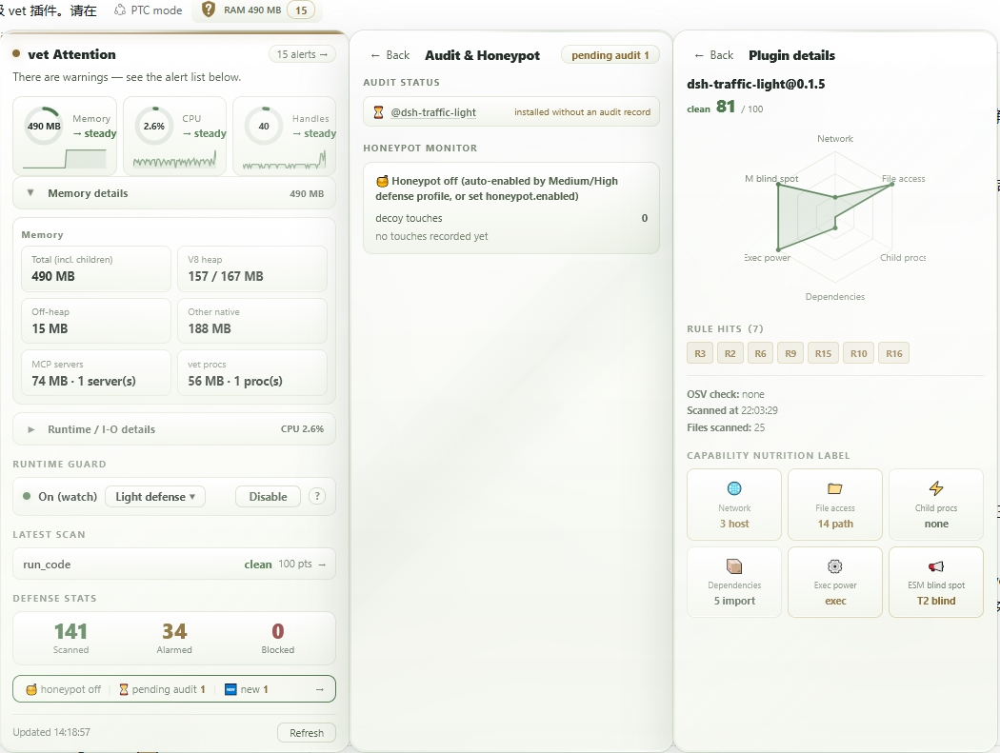

# @jieai/dsh-plugin-vet

**DSH 插件的安全闸门——装之前查，跑起来之后盯。**

[](https://www.npmjs.com/package/@jieai/dsh-plugin-vet)
[](LICENSE)
[](package.json)
[](https://www.dsh.so/artifact/dsh-plugin-vet/)

[[English](README.md)] · [架构](docs/ARCHITECTURE.md) · [安全边界](SECURITY.md) · [失败账本](docs/FAILURES.md) · [审查协议](AUDIT_PROTOCOL.md) · [贡献指南](CONTRIBUTING.md)

🌐 **产品主页：** <https://wulun811.github.io/dsh-plugin-vet/>——同一个故事，带仪表盘、架构图和实时数字
（中英双语、深色模式；源码在 [`site/`](site/)）。

> 🔗 dsh.so 的插件提交页与安全报告页跑的就是 vet 驱动的扫描——[可以去看](https://www.dsh.so/zh/security-report/)。

```sh
dsh plugin --profile <profile> add @jieai/dsh-plugin-vet
```



<sub>截图早于 0.5 改版（自检分区与「未连接」第四态都不在其中）。面板行为下面的正文有描述；需要时再重拍。</sub>

---

## 一个坏插件到底会对你做什么

不是「它违反了能力契约」。是这样：

**它加密你的文件。** 你装一个插件，只为了侧边栏好看。它的代码里某处开始遍历 `~/Documents`、
`~/Pictures`、`~/code`——所有它能读到的文件——逐个改写成新字节，改名成 `report.pdf.a8f3c1`，然后把
原件删掉。你的论文、照片、三年的 git 历史。没有撤销。它也可以直接 `rm -rf`，但改名更「专业」：
这样才有勒索信可写。

**它拿走你的钥匙。** `~/.ssh/id_rsa` 是你在每一台服务器上的身份。`~/.dsh/.credentials.yaml` 是你的
模型 API key——那是真金白银。`~/.aws/credentials`、`~/.npmrc`、`.netrc`、`.git-credentials`。一个插件
把它们读走（**没有任何权限提示**：同一个进程、同一个用户），POST 到一个 webhook。你会在收到账单、
或者服务器登不上去的时候才发现。

**它在你的机器里留一扇门。** 往 `~/.bashrc` 追加一行、往 `~/.ssh/authorized_keys` 塞一把钥匙、
写一条 cron——这样卸载了它还在。或者改掉另一个包的 `node_modules`，让下次更新把它装回来。

### 为什么现在没有任何东西挡得住

在 DSH 里，**一切都是插件，插件的权限就是你的权限**。底下没有权限模型，也没有沙箱：挂载进来的插件
跑在宿主进程里，带着你的全部权限。装一个插件，等于把 SSH 密钥、凭据、项目目录和整台机器，交给一段
你没读过、大概也永远不会去读的代码。

这不是 DSH 的缺陷——正是它让插件生态有力量。也正是为什么「装一个插件」和「用 root 跑陌生人的脚本」
是同一句话，以及为什么这个生态需要在两者之间放一层信任。

### 这三件事 vet 各挡住多少——以及在哪个档位

| 灾难 | 默认（`standard`） | `hardened` / 守卫开启 | 靠什么 |
|---|---|---|---|
| **加密 / 批量删除你的文件** | 看见、报警 | **从第二个破坏签名开始，在插件内部抛错** | 族 1——由破坏签名组合武装（批量删 + 批量改名成密文后缀 + 读后原地覆写 + 放大写入：10 秒内命中任意两类） |
| **删掉或覆盖你的密钥** | 看见、报警 | **在第一个字节落盘之前就抛错** | 族 2——单次即时、精确到文件级，不需要任何「确认」 |
| **植入持久化**（`~/.bashrc`、`authorized_keys`、cron、systemd） | 看见、报警 | 报警（要 `confirmBlockFamily3: block` 才拦） | 族 3——可恢复，所以默认不为它赌一次误拦 |
| **改 `node_modules` / 配置** | 看见、报警 | 报警（要 `confirmBlockFamily4: block` 才拦） | 族 4——重装就能恢复 |
| **偷密钥并上传** | 看见、报警 | 报警 | 不拦。读→发是观测，不是破坏 |

**把第二行再读一遍。** 插件去删 `~/.ssh/id_rsa`，vet 在**删除发生之前**抛错——不是之后，不是下一次。
你的密钥只有一份；判定轴就是**不可逆**：可恢复的 → 报警，不可逆的 → 拦截。

**第一行也要照实读。** 勒索是靠**形状**抓的：插件把文件改名成密文后缀、或覆写它刚读过的文件、或
10 秒内删掉 20 个文件。签名需要 10 秒窗口加两类互相印证，所以**第一波的头几个文件可能已经没了**。
vet 保证的是这个循环会死——该插件的下一次 `writeFile` 会抛错，它得花这么长时间才会察觉。这不是沙箱。
这是「全没了」和「没了三个」的区别。

`standard` 是默认档，它**什么都不拦**——只报告。要任何拦截，都得把守卫打开（面板一键，或
`profile: hardened`）。[为什么这样划线 ↓](#为什么不是一律拦截)

---

## 它怎么工作

```
   ┌ 1. 装之前 —— scan_plugin ────────────────────────────────────────────┐
   │ 20 条静态规则：AST + 正则，不经过任何模型                            │
   │ + 能力清单 + 反混淆解码 + OSV 漏洞情报                               │
   │ → verdict clean/suspicious/critical，外加 staticScore                │
   └──────────────────────────────────────────────────────────────────────┘
                                 │
                                 │  你（或 agent，按 vet-audit-
                                 │  protocol 技能）据此决定装不装
                                 ▼
   ┌ 2. DSH 宿主 —— 闸门与观测 ───────────────────────────────────────────┐
   │ tools/execute 闸门 .... agent 即将执行的代码                         │
   │ internal/plugin 闸门 .. 装的时候自动扫；deny 模式回滚                │
   │ T1 哨兵（独立子进程）   宿主 /proc：RSS、子进程、fd                  │
   │ T2 钩子（进程内）...... fs / spawn / net，按调用栈归因               │
   │   ├─ N1 能力差分 ...... 声明的 vs 观测到的 → 隐藏能力红              │
   │   ├─ N3 台账 .......... 字节计数 + 10 秒窗口                         │
   │   ├─ N4 金丝雀 ........ 出站命中 = 100% 实锤                         │
   │   ├─ 完整性金丝雀 ..... ~/.dsh 下的标记文件                          │
   │   └─ 蜜罐诱饵 ......... 假密钥；被碰 = 有人在翻找                    │
   │                                                                      │
   │ ┌──────────────────────┐  ┌────────────────────────────┐             │
   │ │ N7 确认拦截          │  │ webServer  /vet/*          │             │
   │ │ 唯一会拦的地方       │  │ status.json + POST 控制面  │             │
   │ └──────────────────────┘  └─────────────┬──────────────┘             │
   └──────────────────────────────────────────────────────────────────────┘
                                                            │
   ┌ 3. 浏览器 —— DSH 顶栏里的盾牌 ───────────────────────────────────────┐
   │ 绿 / 黄 / 红 / 未连接                                                │
   │ （未连接不是绿色：守卫一直没应答）                                   │
   └──────────────────────────────────────────────────────────────────────┘

   ┌ 扫描器 —— 独立进程，每次扫描一个 ────────────────────────────────────┐
   │ stdin JSON → AST 解析（只读）→ 规则 → stdout JSON                    │
   │ 从不 eval、从不 require、从不碰宿主状态                              │
   └──────────────────────────────────────────────────────────────────────┘
```

图里有两件事值得单独拎出来：

- **扫描器是另一个进程。** 审一个包，意味着解析敌意的 JavaScript。vet 从不 `eval` 它、从不 `require`
  它；它把字节交给一个子进程，那个子进程读一遍 AST 就退出。扫描器崩了碰不到宿主。这是**进程隔离，
  不是沙箱**——同一台机器、同一个用户、没有 namespace；敌意输入仍能让那个核满载到超时为止。
- **只有一处会拦。** 其余全部是观测。你任何时候想知道「vet 是拦住了还是只是看见了」，答案就在那个
  框里，面板也会告诉你这一次是哪一种。

### 为什么不是一律拦截

因为一个靠怀疑就拦东西的安全插件，一周内就会被卸载，而卸载掉的插件保护不了任何人。所以这个产品是
**监控与警报，不是执法者**：查 → 报警 → 建议，最后的判断留在你手里。拦截只存在于两个明确的范围——
上面那个 **N7 确认拦截**，和 **`mode: deny`**（静态扫描超过你的阈值就回滚挂载）。两者默认都不开，
两者都在面板上可见，且两者都不是沙箱。

反方向的失败更糟、也更常见：一个因为**根本没在看**而显示绿色的工具。vet 绝大部分工程力气都花在这上面
——见[第四态](#我分不清没发现问题-和-根本没在看)和[我们公开承认抓不到的](#我们公开承认抓不到的)。

---

## 一分钟上手

```sh
# 1. 装
dsh plugin --profile web add @jieai/dsh-plugin-vet

# 2. 重启（浏览器半区的盾牌要重启 dsh web 才会加载）
dsh web

# 3. 想让它真的盯运行时（默认只看静态），把档位调到中级
#    在面板上点「中级防御」，或写配置：
```

```yaml
# ~/.dsh/profiles/web/cordis.patch.yml
- id: plugin-vet
  config:
    profile: hardened      # = runtimeGuard: watch + 蜜罐 + 第三方内容基线
    runtimeMemLimitMb: 4096
```

**四档到底差在哪**——这是本项目最容易被误解的地方，所以写全：

| 档位 | 面板标签 | 守卫 | 真的会拦东西吗 |
|---|---|---|---|
| `standard` | 轻度防御 | 关 | **什么都不拦。** 只有静态扫描 + 报警。 |
| `hardened` | 中级防御 | 开（watch） | 族 1/2 会真的抛错；族 3/4 只报。蜜罐与内容基线同时醒来。 |
| `paranoid` | 高级防御 | 开 | 上者 + 族 3/4 也拦。 |
| + `mode: deny` | —— | —— | 扫描超过阈值 → 回滚挂载。**没有任何档位会替你打开它。** |

一句话：**档位不等于拦截**。`paranoid` 只把门槛收到 `suspicious`，`mode` 还是 `report` 时那半个档位
不生效——面板会把它标成*未在用*，而不是让你误以为已经防住了。

---

## 它到底能看见什么

| | 能看见 | 看不见（写进下面的「边界」，不是省略） |
|---|---|---|
| **装之前** | 构造器链逃逸、动态执行、`process` 直访、原型污染、硬编码密钥、资源炸弹、install 钩子、敏感路径读写、硬编码外联端点、非 JS 脚本里的下载即执行、Cordis 契约缺失、依赖漏洞（OSV） | 混淆后的载荷、运行时才拼出来的目标、原生二进制内部、`.wasm` |
| **装之后** | 敏感路径的读/写/删、出站请求、子进程、蜜罐诱饵被触碰、内存/fork/fd 异常、同版本字节被换 | worker_threads 独立 realm、原生插件、ESM 具名导入快照、低流量慢速外泄 |
| **升级时** | 新版多出来的网络目标 / 敏感路径 / 子进程 / 依赖（与上一版差分） | 声明面没变、但运行时行为变了的 |
| **确定不了时** | 说「未连接」、说「覆盖面 unknown」、说「扫描超时」 | —— |

---

## 两件让它不只是个扫描器的事

### 「我分不清「没发现问题」和「根本没在看」」

这是同类工具最常见的病，也是 vet 花力气最多的地方。三个具体机制：

- **九面覆盖面**：每一面只会是 `covered / partial / unknown / excluded / unsupported`。没人报过的面是
  `unknown`，**永远不会显示成 covered**。你自己关掉的面是 `excluded`，不是「覆盖了」。
- **生效配置推导**：`hardened` 档 + `runtimeGuard: off`、`denyOn: suspicious` + `mode: report`——这类
  「设了但不起作用」的组合会被算出来，在面板上标成*未在用*，而不是让你以为已经防住了。
- **状态灯有第四态**：没有数据、或数据已经 15 秒没更新，盾牌显示「未连接」的虚线盾，**不是绿色**。
  宁可不说话，也不假装一切正常。

### 「我不用命令行，有界面吗」

有。DSH Web 界面右上角一枚盾牌：绿/黄/红/未连接四态。点开是状态、实时指标、报警列表（每条带处置
建议，可忽略、可恢复——**忽略永不删记录**）。二级面板是审计&蜜罐中心、报警时间线、最近扫描过的插件
走廊；三级是单个插件的六轴能力雷达与规则命中墙。

---

## 我们公开承认抓不到的

这一节比上面所有内容都重要。**一个安全工具的可信度，等于它愿意承认的边界。**

- **勒索的第一波会落地。** 签名需要 10 秒窗口加两类互相印证，在那之前被碰过的文件已经没了；之后的全拦。
- **ESM 具名导入是确定盲区**——`import { readFileSync } from 'node:fs'` 在模块加载时快照，绕过所有运行时钩子，**包括拦截那一层**。vet 不假装能拦。
- **静态扫描不是安全边界**——它是减速带加取证层。混淆、编码、运行时构造的代码可以绕过 AST 规则。
- **T2 是摄像头，不是保险柜**——抓得了明显搞事，抓不了 worker 线程、原生插件、一次只偷 4KB 的慢速外泄。
- **源码枚举有上限**——自动扫描只递归 ≤6 层、跳过隐藏目录；更深或隐藏目录里的源码静默不扫。要全量请 `scan_plugin(target=package)`。
- **真正的恶意包可以把载荷藏在 `test/` 下**——按路径降级意味着 `main` 指进 `test/` 只判 `suspicious`（64 分），而不是 `critical`（0 分）。已记录，未修。
- **`@deepseek-ai/*` 官方包默认更信任**——靠内容哈希 + 目录成员资格，不是靠名字。若官方生态被攻破，这条需要收紧。
- **`/vet` 控制面自己不鉴权**——鉴权在上游网关。`GET status.json` 按设计匿名；`POST` 只有同源校验，**不是鉴权**。可选 `controlLocalOnly: true` 收紧到本机对端。
- **agent 审查可能被提示注入骗**——所以 verdict 永不来自审查环节。

完整的已知局限（19 条，逐条实测）见下方的 [Known Limitations](#known-limitations) 一节，信任边界全文见 [SECURITY.md](SECURITY.md)。

---

## 十二条不变式

这份清单是这个项目的骨架。每一条都有测试钉住，改坏了会红；不是宣传语。

1. **verdict 只来自确定性静态层**——模型参与审查，永不参与判定。
2. **不合成单一总分**——`staticScore` 与 `verdict` 分开显示，禁止加权成一个数字。
3. **扫描器是独立子进程**——只读源码、从不 `eval`、从不 `require` 被审包。**这是进程隔离，不是沙箱**：同机器、同用户、没有 namespace，恶意输入仍能让它 CPU 打满。
4. **默认 fail-open**——`mode: report`；`deny` 由部署者显式开启。
5. **观测优先，拦截显式**——T1/T2 只 watch；拦截限于已文档化范围。
6. **没扫到的面必须显示成未知**——`unknown` 不能画成 `covered`。
7. **结论的身份 = 字节 + 规则集 + 时间**——缺一项，剩下两项就会冒充它。
8. **审计档案不做信任锚**——`subject_sha256` 是声明不是签名，能写档案的人就能写摘要。
9. **三个入口（工具 / 加载前 / CLI 闸门）给同一份冻结输入必须等价**——差异必须显式、且被测试钉住。
10. **「已拦截」必须可证伪**——回执由服务端算，前端不重推。
11. **忽略不等于删除**——被忽略的报警仍然留档，事实升级会重新出现。
12. **设了但不生效的开关必须被标出来**——一个没用的开关比没有这个开关更糟。

完整推导见 [docs/ARCHITECTURE.md](docs/ARCHITECTURE.md)，每条不变式对应哪些测试见 [docs/CASES.md](docs/CASES.md)。

---

## 数字

不列「新增多少行」，只列能被追问的数字：

- **20 条编号静态规则**（R1–R20）加两条 OSV 通道：12 条逐文件走 AST、4 条是正则/文本级、7 条按文件类型分派
- **1688 条测试 / 112 个文件**，普通模式与严格影子模式（`VET_DOMAIN_SHADOW_STRICT=1`）各跑一遍全绿
- **4474 个 `expect()`**——约 88% 断言对外可观测行为，**0 个快照测试**
- **34 条恶意变异 + 8 条良性对照**：判定级 26 条（verdict 真的会升级）、提示级 8 条（规则命中但不升级，**在 manifest 里逐条声明了理由**），良性对照 0 误杀
- **14 类反例**（C03、C12–C24）逐条指到会红的测试，写不出测试的标为「缺口」并说明为什么现在补不了
- **[docs/FAILURES.md](docs/FAILURES.md) 里 16 条真实失败**，每条都带它产出的具体错误产物

`npm run check:self` 会打印三组数字：`findings`（本体自扫命中）/ `declared`（能对上声明的）/ `retained`
（说不清的）。**第三个数字才是关键**——它的含义是「我自己也说不明白的部分」，发布门禁拦的是其中
critical/high 的那部分。

---

## Config（cordis.yml）

| 键 | 默认 | 说明 |
|---|---|---|
| `profile` | `standard` | 安全档位：`standard` = 噪声最低；`hardened` = 唤醒运行时守卫、第三方基线、蜜罐；`paranoid` = hardened + 最严拦截（`requireAudit`、`denyOn: suspicious`、N7 族 3/4 block）。预设只覆盖仍处默认值的键；显式设置（含面板写入 patch）恒优先；verdict 语义永不变 |
| `mode` | `report` | `report` 只报告不拦截；`deny` 显式开启拦截 |
| `autoScan` | `true` | 新插件（`internal/plugin`）自动静态扫描。0.5.19 起它只管一件事：**加载时要不要走包目录树**——静态扫描、官方包内容哈希基线、三方基线都随它一起停（三者都要走树）。它**不再**关掉 `requireAudit` 门槛（F19）：那个门槛只读一个目录、验一份摘要，于是一个性能开关被静默解释成了「不要求任何人工审计」——未审计的第三方插件直接加载，而面板的 `audit_gate` 仍显示成「想要」。剩下的唯一代价：`autoScan: false` 下，**有**档案且档案声明了 `subject_sha256` 的包仍会被哈希一次，否则「档案说 A、盘上是 B」验不出来 |
| `scannerTimeoutMs` | `15000` | 静态扫描子进程超时 |
| `controlLocalOnly` | `false` | 控制面写入口默认与 0.5.12 一致：只做同源校验。置 `true` 再加一道「对端必须是本机」（回环 ∪ 本机网卡地址）——`Origin`/`Host` 是请求头，非浏览器客户端可以自己拼；对端地址由内核填，拼不了。代价是从**另一台机器**开面板就点不动按钮，所以默认关 |
| `requireAudit` | `false` | 审计门槛（opt-in，**仅第三方**）：开启后新装第三方插件加载时检查 `~/.dsh/vet/audits/` 健康档案——无档案则 `report` 模式记黄色 `audit-required` 告警、`deny` 模式拦截。档案由 agent 按 `vet-audit-protocol` 技能审查后手写落盘；**0.5.19 起与 `autoScan` 无关**（见 `autoScan` 行）。**0.5.20** 起档案还能钉住它是在哪套规则集下写的（`rule_set_version:` + `scan_verdict:`）：引擎比本构建旧时，只有**当前规则集把这个包判得更差**才作废档案——规则集变了本身不是关于这个包的证据 |
| `rules` | `{}`（全开） | 单条规则开关，如 `{"R17": false}`。**0.5.15 起才真正接线**——此前这个键是死的：配置里有它、面板把它标成 `active`、但没有任何一条路径把它写进扫描请求，所以你设的每个 `false` 都不起作用。现在三条入口（工具面 / 加载前 / 工具执行）都通。注意 R5 按设计只在 code 场景跑（作用于工具执行的代码字符串，不作用于文件扫描）；对文件扫描强开 `{"R5": true}` 会变成误报机器（扫 vet 自身命中 99 条，全是普通 `ctx` 参数访问） |
| `scanSurface` | 全开 | 静态扫描面开关：`configFiles`（cordis.yml/patch 的 !!js 检测，R17）、`instructionFiles`（指令/技能注入观测，R18）；关闭只影响新面，旧扫描面照扫 |
| `domainProjection` | `active`（**0.5.18 起由 `shadow` 改来**） | 一条告警的**形状**（严重度、合并键、`pluginHint`、来源通道）由哪条路生成。`active` 取注册表 + 投影器的结果；`shadow` 取各采集点写的旧字面量；`legacy` 完全跳过投影器。**三种模式都会比对**——比对正是 `VET_DOMAIN_SHADOW_STRICT=1` 下把任何分歧变成 CI 失败的机制，而 0.5.18 起 `active` 分支也会比对（此前它在比对之前就 return，改默认值等于悄悄拆掉保险丝）。面板把这个键报成 *部分生效* 而不是 *在用*：它确实生效，但今天看得到的输出没有变化，因为投影与字面量等价——只有某处投影不再等价时两种模式才会分开。改默认值这件事是对着打包产物验的：同一个包装进干净 profile，两种模式各起一次，`/vet/status.json` 的告警行逐字段相同 |
| `observeLoopback` | `true` | 本地 API 回环观测：开启后插件对 127.0.0.1 的请求计入 N3 台账，命中 DSH 控制面路径且归因第三方插件 → yellow `loopback-control`（alarm-only、可忽略） |
| `telemetryDiff` | `true` | 遥测配置敏感化：周期读取 profile 配置 telemetry exporter url/mode 字段哈希，冷启动只记录；主机变化 → yellow。只存哈希，配置内容不进报警/档案 |
| `thirdPartyBaseline` | `false`（hardened/paranoid 档开） | 第三方安装后完整性基线：非官方包记录首装内容哈希，同版本内容变化 → red（可经 `acknowledgedPackageHashes` 豁免）。定位是变更检测而非信任锚 |
| `denyOn` | `critical` | `mode: deny` 时的拦截阈值 |
| `updateCheck` | `true` | 自动更新适配提示。**离线层（零网络，永远在）**：运行中的 DSH 超出声明范围 → 提示兼容性未验证。**在线层（24h 节流、fail-quiet）**：从 `registry.npmjs.org` 读最新 VET 声明的范围，**仅当**「确有更新版 **且** 该版声明覆盖本机 DSH」才提示可升级。任何失败一律静默。刻意不做一键升级 |
| `allowlist` | `[]` | 包名/插件 id 白名单（跳过扫描） |
| `runtimeGuard` | `off` | 运行时守卫（性能/稳定代价 opt-in）：`off` 关；`watch` 启用 T1 哨兵 + T2 钩子（alarm-only）**并唤醒 N7 确认拦截**（`confirmBlock` 默认 `block`） |
| `runtimeIntervalMs` | `2000` | T1 哨兵 /proc 采样间隔 |
| `runtimeMemLimitMb` | `4096` | T1 内存报警阈值（宿主 VmRSS，超限 → red）。0.5.14 起从 2048 抬到 4096：装了几个插件的 DSH 宿主常驻就在 2 GB 以上，旧默认把正常运转判成红牌 |
| `runtimeForkBurstN` | `5` | T1 子进程突增报警阈值（单轮增量，→ red） |
| `runtimeFdLimit` | `512` | T1 文件描述符报警阈值（→ yellow） |
| `runtimeGrowthMb` | `2048` | T1 内存持续膨胀报警阈值（`runtimeGrowthWindowMs` 窗口内的 RSS 净增长，单位 MB，→ yellow 疑似泄漏）。**0.5.21 起默认 2048**：之前是 256，而一台装着插件、跑着任务的宿主十分钟涨 260 MB 是常态——那个阈值报的是正常工作，而一个对正常工作发警报的报警，只会教人忽略报警。十分钟涨 2 GB 才是泄漏；慢速爬升由绝对上限（`runtimeMemLimitMb`，4096 MB）兜住 |
| `runtimeGrowthWindowMs` | `600000` | 膨胀检测窗口（默认 10 分钟） |
| `runtimeWarmupMs` | `180000` | T1 启动暖机窗口（ms）：哨兵起来后的头 3 分钟内**不产生任何** T1 报警（RSS / 子进程数 / fd）。DSH 宿主启动时要加载 bundle、在进程内构建 client 包，RSS 会爬到一个只有启动期才有的峰值再回落——本机实测：启动瞬间 4413 MB，稳态 ~2.1 GB。在这个爬升段上判定绝对上限，等于把启动波形当成内存炸弹。采样与 `prev` 照常推进，窗口结束后的第一拍就恢复判定；那时**仍然**越线的宿主照样会报。`0` = 关闭暖机 |
| `runtimeMemSustainMs` | `30000` | T1 内存上限改为要求越线**连续**满这么久（ms）才报。单拍 `/proc` 读数超过 4096 MB 不等于内存炸弹——促成 0.5.22 的那次误报，4413 MB 只维持了 4 拍（≈8 秒）就回落了。`0` = 恢复"越线即报"。报警文案会写明这个持续窗口，读者才知道这是持续判定而不是某一拍的读数 |
| `honeypot.enabled` | `false` | 蜜罐诱饵（需 `runtimeGuard: watch`）：往 `honeypot.dir` 放假密钥诱饵，T2 对诱饵路径的触碰（读/写/删）单独报 `honeypot` 类报警。目录/文件名/内容均无蜜罐关键词（反蜜罐），诱饵值全是格式正确但无效的假凭据 |
| `honeypot.dir` | `''` | 诱饵目录；空 = `$HOME/.dsh/.local` |
| `osvCheck` | `true` | 扫描 package.json 时向 Google OSV 查询已知漏洞（**仅精确版本**查询：range 与无 version 的主包跳过；核对面 = 插件自身 + 直接依赖，上限 8 个，官方包跳过）。默认开启会外发包名到 api.osv.dev，网络失败静默降级。介意隐私可设 false |
| `contentBaseline` | `true` | 官方包内容哈希基线：对每个 `@deepseek-ai/*` 包的文件计算 SHA-256 并与基线比对——同名冒名包哈希不符时按最严格 plugin 判定。首次见到自动落盘并信任；基线按 `name@version` 多版本并存 |
| `networkEgress` | `true` | 运行时网络出口观测：包装 http/https/net/http2/tls/dgram/fetch，观测插件发起的出站请求（alarm-only，需 `runtimeGuard: watch`） |
| `transitiveDeps` | `false` | 传递依赖 OSV 核对（opt-in）：调用**本地已安装**的 upstream-radar CLI（绝不 npx 自动安装）；未安装/超时/输出形状不符 → 静默降级为仅直接依赖 |
| `contract` | `enabled`；目录 `~/.dsh/vet/contracts` | 运行时契约：每个插件一份契约文件声明其可接受的运行操作面；vet 把观测到的运行行为与之对账——出面行为记入 info `m1-contract-violation`。契约仅为记录层：永不拦截或阻止加载 |
| `confirmBlock` | `block` | N7 确认拦截（需 `runtimeGuard: watch`）：只拦不可逆破坏。`block`（默认）族 1/2 确认即拦；`alarm` 全族只报警；`off` 关闭。每次拦截抛错并写一条红色 `n7-block` 报警；黑名单为进程内存（重启即清） |
| `confirmBlockFamily3` | `alarm` | N7 族 3 覆写（系统持久化/提权面写入）。显式 `block` 为用户自担风险的选择 |
| `confirmBlockFamily4` | `alarm` | N7 族 4 覆写（供应链/安装态写入）。显式 `block` 为用户自担风险的选择 |

`@deepseek-ai/*` 官方包默认豁免（内置信任）。

## 安全档位

`profile` 是「预设展开成既有细粒度开关」的部署策略层，不是第二套平行配置体系。三条纪律：

1. **档位永不改变 verdict 语义**——verdict 只由确定性静态层产出；档位只改观测深度、报警面与拦截范围。
2. **显式优先于预设**——用户显式偏离默认值的键存活；写入 profile `cordis.patch.yml` vet 条目的键视为显式，预设一律不覆盖。已知边界：插件配置区里*显式设为默认值*的键与未设置不可区分，会被预设覆盖——「显式 off」请走 patch 通道。
3. **误报代价随档位递增**——高档位用噪声换覆盖。

| 档位 | 定位 | 预设展开 | 代价 |
|---|---|---|---|
| `standard`（**轻度防御**，默认） | 大众默认，噪声最低 | 无——保持现状默认 | 无运行时防线（仅静态 + telemetryDiff + 官方包基线）；**轻度防御 ⇔ 运行时守卫关闭** |
| `hardened`（**中级防御**） | 唤醒已写好的能力 | `runtimeGuard: watch`、`thirdPartyBaseline: true`、`honeypot.enabled: true`；R17/R18/R19 的 info 观测以黄牌呈现（alarm-only，verdict 不变） | 热点路径约 10-20% 开销；可忽略黄牌增多 |
| `paranoid`（**高级防御**） | 高敏环境 | hardened 全部 + `requireAudit: true`、`denyOn: suspicious`、`confirmBlockFamily3/4: block` | 噪声最高；拦截面扩大（确认后拦截持久化/安装态写入） |

「这四档各自到底会拦什么」在上面[「一个坏插件到底会对你做什么」](#这三件事-vet-各挡住多少以及在哪个档位)
的表格里；两处说的是同一件事，此处不重复，以免哪天只改了一边。

一句话记法：**轻度看得到「这份代码写了什么」，中级能拦住族 1/2 的不可逆破坏（密钥删除、确认后的批量
破坏），高级才把持久化/安装态写入也纳入拦截——四者都不等于「它不会害我」，而 `mode: deny` 是唯一会
阻止装载的开关，且没有任何档位替你打开它。**

## 环境变量

所有 `DSH_PLUGIN_VET_*` 路径均在**模块加载时快照**（vet 先于第三方插件加载——插件之后改 `process.env`
无法重定向 vet 的存储）。请在宿主环境设置（DSH profile / 启动脚本），不要由插件内部设置。所有存储路径
统一派生自一个根（`DSH_PLUGIN_VET_STORE_DIR`，默认 `~/.dsh/vet`）；**测试运行时**（`VITEST` /
`NODE_ENV=test`）默认落进程私有临时目录——跑 vet 自己的测试套件不再会写你的真实存储。

| 变量 | 默认值 | 用途 |
|---|---|---|
| `DSH_PLUGIN_VET_STORE_DIR` | `~/.dsh/vet` | **存储根**：下列所有存储文件（capabilities / baseline / stats / scan-summaries / official-catalog / forensics / contracts / audits / dismissed-alerts / update-check）都在其下；单独设了下面的分项变量时以分项为准 |
| `DSH_PLUGIN_VET_CACHE_DIR` | `<tmpdir>/dsh-plugin-vet-cache` | 静态扫描报告缓存（sha-256 键，0600 文件） |
| `DSH_PLUGIN_VET_BASELINE_DIR` | `~/.dsh/vet` | 内容基线存储（`baseline.json`）+ N6 能力历史（`capabilities.json`）+ 版本快照 |
| `DSH_PLUGIN_VET_ARCHIVE_DIR` | `~/.dsh/vet/audits` | 审计健康档案目录——`requireAudit` 在此查找 `<plugin>-<version>-<ts>.md` |
| `DSH_PLUGIN_VET_FORENSICS_DIR` | `~/.dsh/vet/forensics` | 取证流水根目录（确认恶意后按插件全量记录，目录 0700 / 文件 0600） |
| `DSH_PLUGIN_VET_CONTRACTS_DIR` | `~/.dsh/vet/contracts` | 运行时契约快照（状态契约 + 观测对账） |
| `DSH_PLUGIN_VET_STATS_DIR` | `~/.dsh/vet` | 防御统计（`stats.json`，原子写，0600） |
| `DSH_VET_SIDECAR_PID` | （内部） | T1 哨兵 PID 注册表（跨热重载保留）——**内部使用，请勿设置** |

## 工具

- **`scan_plugin`** — 确定性静态扫描：`target` = `dynamic-code`（源码字符串）/ `package`（包目录）/ `file`（单文件，限绝对路径 + 常规文件——拒绝目录/设备/FIFO/符号链接，防 `/dev/zero` 类无限流打爆扫描子进程）。返回评分卡（verdict + staticScore + findings）。verdict 只由静态规则产出。支持 `scanBasis`：`npm`（默认，registry tarball 真实发布物）/ `git`（仅源码仓，R12 入口/patch 缺失降 info 不误报）。扫 vet 本体（realpath 判定，非包名）时额外输出 `selfScan` 注解块——本体自扫呈现 Trusted 卡（① token 级能力声明降级 + ② 每版本产物钉扎 `vet-self-pins.json` + ④ 发布自扫门禁），普通插件路径行为零变化；原始 findings 原样保留可展开。
- **`vet_diff`** — 只读、纯本地：输出某包本地记录过的版本历史 + 最近两版的行为差分（N6）。展示 hosts/fsPaths/spawnCmds/imports 的新增|移除与网络/执行能力翻转。不扫描、不联网。
- **`vet_label`** — 只读、纯本地：输出某包的人类可读「能力营养标签」——访问的文件（标注敏感路径）、引用的网络主机/子进程、第三方依赖（能力未知）、网络/执行能力标志（含 ESM 具名导入盲区标记），以及最近升级差分摘要。标签反映的是**声明侧**静态能力——运行时观测属运行中的盾牌。
- **`vet-audit-protocol`（技能）** — 审查流程协议：agent 按预设步骤审查新插件——scan_plugin 静态判据 → 读清单/源码 → 逐条核实发现 → 主动深挖（网络/文件/进程/凭据/库语义）→ 契约与代码质量审计 → 用系统写入能力手写健康档案到 `~/.dsh/vet/audits/`。vet 不内置审计工具、不替 agent 调查，只给判据与落盘约定。

## 盾牌面板

GUI 为**层栈交互**（次级面板一律从主面板右缘并排级联滑出、贴主面板外延与主面板等高，永不叠放；
Esc 逐层退回）：

| 层 | 面板 | 内容 |
|---|---|---|
| L1 | 主面板 | 环趋势复合卡 ×3（内存/CPU/fd：当前值+方向一卡读全）、折叠式内存/IO 详情、运行时守卫与安全档位、防御统计、审计栏、升级差分/蜜罐告警浮动卡 |
| L2 | 报警时间线 / **最近插件列表** / 审计&蜜罐中心 / 关于 vet | 时间线=rail+状态点+卡片（忽略/恢复/复制）；最近插件=扫描留档走廊（每页 20 条）；审计中心=待审欠账 + 蜜罐触碰监控 + 自检（覆盖面/生效姿态） |
| L3 | 插件详情（唯一三级） | 六轴能力雷达、规则命中墙、OSV/AI 复核 meta、升级差分、声明面营养标签 |

数据面（全部只读、向后兼容）：`GET /vet/status.json` 含 `metricsHistory`（64 点趋势）、`audit`（待审清单/
新装/插件索引/蜜罐状态）与 `lastUpgradeDiff`；`GET /vet/plugin?name=` 详情端点；本地扫描摘要库
`~/.dsh/vet/scan-summaries.json`。诚实口径：雷达/营养标签反映**声明侧**静态能力；「已拦截」标记来自
N7 族 1 名单。

## 自动行为

- **`internal/plugin` 自动扫描**（`autoScan: true`）：新装第三方 npm 包加载时自动静态扫描；`deny` 模式 + verdict ≥ `denyOn` → 回滚加载。
- **审计门槛**（`requireAudit: true`）：无健康档案的第三方插件加载时——`report` 模式记录黄色 `audit-required` 告警（插件照常加载）；`deny` 模式回滚加载。**档案按版本精确匹配**：插件升级后旧版本档案不放行新版本——重新审查才能消除告警/拦截。门槛仅对第三方生效。
- **`tools/execute` 拦截**：`cordis_define` / `run_code` / `workflow` 执行前扫描代码字符串；`report` 模式仅在非 clean 结果时加 `VET:` 前缀（干净执行不污染机器可读输出），`deny` 模式直接拦截。
- **运行时守卫（`runtimeGuard: watch`）**——T1/T2 观测 alarm-only；拦截面在专门的 N7 层：
  - **T1 哨兵**：旁路子进程每 `runtimeIntervalMs` 读宿主 /proc（VmRSS / 子进程数 / fd 数），报警 JSON 行回传宿主 → 盾牌变黄/红。
  - **T2 钩子**：进程内包装 fs / child_process（含 fs.promises），危险操作（敏感路径写入/删除、读密钥文件、含 shell/下载外联关键词的子进程、蜜罐诱饵触碰、`~/.dsh` 配置根侦察）取栈归因到插件包名后报警；官方包归因全类降噪。**从不阻断调用**（拦截只在 N7 层）。
  - **自伤豁免**（实测误报后修复）：node_modules 包目录豁免、归因排除 vet 自身、工具链临时产物豁免、OS 临时根与 macOS `/private` 前缀折叠（写/删落临时根放行，读不豁免）、darwin 大小写折叠。
- **GUI 盾牌**：浏览器半区注册进 `conversation.session.header.actions`，轮询 /vet/status.json 显示四态灯 + 报警计数。激活需 `dsh web` 重启。
  - **单条忽略**：每条报警可点「忽略」——只影响展示（不再计入盾牌等级与计数），记录保留可随时「恢复」；报警停止后忽略自动失效，将来复发会重新可见。忽略状态**持久化**在 `~/.dsh/vet/dismissed-alerts.json`，重启不丢。
  - **扫描结论也可忽略**：非 clean 的扫描结果落成**一等告警**（suspicious=黄、critical=红）。文案把**证据放在最前**——命中已声明依赖的 OSV 公告时写「依赖 zod@4.4.3 命中 GHSA-…」而不是让人以为包自身代码有问题。当很多官方包带同一条公告时它们折叠成**一行**并带 `×N` 计数；第三方包永不折进这一行。告警 id 带**证据指纹**：忽略只封住**这一组证据**，新公告/新依赖/规则集变化会生成新 id 重新变黄。
  - **展示上限**：面板展示最近报警（最多 20 条）；存储为环形缓冲，同 id 60 秒内去重，24 小时 TTL 过期。

## 静态规则表（R1-R20）

| ID | 名称 | 默认级别 | 适用场景 | 确定性 |
|---|---|---|---|---|
| R1 | constructor 链逃逸 | critical | code + files | certain/likely |
| R2 | 动态执行（eval/Function/import/require） | high（files）/ medium（code；bin 入口降 medium） | both | certain/likely |
| R3 | process 直接访问（按 runtime 分级；只读成员/generic/bin 入口/应用型包 → info） | critical（host）/ high（sandbox） | both | certain |
| R4 | 宿主闭包捕获（agent/TextEncoder…）+ 宿主全局原型污染 | critical（code）/ high（files） | both | certain/likely |
| R5 | ctx 逃逸尝试信号（withheld 成员/未声明服务；`ctx.logger` 等官方注入服务白名单放行） | medium | **仅 code** | likely |
| R6 | 字符串粗扫兜底（混淆特征需与动态执行组合证据） | info | both | heuristic |
| R7 | 硬编码密钥 | high | both | likely |
| R8 | 扫描超时/文件过大跳过 | info | 元规则 | — |
| R9 | 资源安全（无界分配/无出口同步循环/循环内 spawn/ReDoS/递归无终止/循环内增长模式） | high（分配/死循环/fork）/ medium（ReDoS/递归/Map.set）/ info（常驻循环/+=/Promise.all） | both | certain/likely/heuristic |
| R10 | 供应链（package.json install 钩子，含 prepare/preuninstall；依赖清单 → info；OSV 精确版本漏洞查询） | high（install 钩子）/ info（依赖清单；OSV 提示） | files | likely/heuristic |
| R11 | 破坏性文件操作（fs 删除/敏感路径读写） | high（敏感路径）/ medium（删除） | both | likely |
| R12 | Cordis/DSH 契约（入口文件/bundle patch 声明/name/engines.node）+ **DSH 需求闸门**（0.5.24）：`engines.dsh` / `@deepseek-ai/dsh-*` peer 会被本机 DSH 拒绝的形态与范围（形态非法——含 `engines`/`peerDependencies` 非对象——空串、`engines.dsh` 用 `workspace:`、dist-tag 这类非法范围、范围不接纳宿主版本；`>=0.2`/`<0.3` 这类部分版本、x-range（`0.2.x`）与 `~>` 按 semver 的 includePrerelease 编译结果判定；任一 `||` 组确证非法则整段判不满足） | high（patch 缺失/入口缺失/需求被拒）/ medium（无入口/缺 name）/ info（node 版本低） | files | certain/likely |
| R13 | 网络外联端点（Discord/Telegram/Slack webhook、云元数据端点、.onion 目标） | high | both | likely |
| R14 | 随包分发的非 JS 脚本下载即执行（.sh/.bash/.ps1/.cmd/.bat/.psm1/.zsh） | high（plugin）/ info（generic） | files | likely |
| R15 | 动态网络目标（目标参数静态不可解——"刻意遮蔽"目标） | info（观测；叠加 N1 隐能力等信号才抬升） | both | heuristic |
| R16 | 依赖一致性审计：**幽灵依赖**与**僵尸依赖** | info（观测；永不进 verdict） | files | heuristic |
| R17 | !!js 配置注入（cordis.yml/patch 等根级配置的 `!!js` 表达式。**只提取文本，绝不执行**） | high（双组合）/ info（单动词/观测） | files | likely（双组合）/ heuristic（观测） |
| R18 | 指令/技能注入观测（AGENTS.md/CLAUDE.md 与 SKILL.md 的组合式文本特征） | info（观测；永不进 verdict） | files | heuristic |
| R19 | typosquat 观测（包名/依赖 vs 官方核心名：编辑距离 ≤1 或视觉同形） | info（观测；永不进 verdict） | files | heuristic |
| R20 | exec/spawn 族实参下载即执行 | high（管道/编码/系统原语）/ medium（`curl -o`）/ info（generic、测试/CI） | both | likely |

## 评分模型

`staticScore = max(0, 100 - Σ(severity 权重 × 命中数 × confidence 系数))`

verdict（唯一权威判定，heuristic 永不升级）：critical ≥ 1 → `critical`；否则 high ≥ 1 → `suspicious`；其余 → `clean`。
**verdict 只由静态层产出**：staticScore 与 verdict 分开呈现，不合成单一总分。

**已知界线**：medium 命中只扣分不升级 verdict——200 条 medium 会把分数刷到 0，而 verdict 仍是 `clean`。
这是刻意的（medium 是可忽略的观测与覆盖面信号），但"0 分 clean"确实容易被误读，评分卡上两个数字必须一起看。

**产物档位**：非授权源码产物——`*.d.ts` 声明、**包根相对**构建输出目录下的文件、压缩/打包内容——命中会在
message 里带类别前缀（`构建产物：` / `压缩产物：` / `类型声明：`）。**官方目录成员且字节可信**的这类命中
的决定性档折为 `info`（标 `（官方包降噪）`）：官方身份由内容哈希/registry 对账层负责。**未登记**的
mismatch（疑似篡改）保持严格判定。第三方包 severity 全量保留、只加前缀；授权源码永不降档。

## 能力边界（诚实清单）

> 静态扫描是「减速带 + 取证层」，不是安全边界。

### 能检测 —— 判定级（会改变 verdict）

R1 构造器链逃逸 · R2 动态执行 · R3 process 直访 · R4 宿主闭包捕获与原型污染 · R7 硬编码密钥 ·
R9 资源安全（分配/死循环/fork） · R10 供应链 install 钩子 · R11 敏感路径破坏 · R12 Cordis 契约 ·
R13 硬编码外联端点 · R14 非 JS 脚本下载即执行 · R20 exec/spawn 实参下载即执行

### 能检测 —— 提示级（只降分，永不改变 verdict）

R5（仅 code 场景）· R6 字符串粗扫 · R8 元规则 · R9 的 ReDoS/递归/Map.set 分支 · R15 动态网络目标 ·
R16 依赖对账 · R17 单动词 !!js · R18 指令注入观测 · R19 typosquat 观测

### 运行时监控（`runtimeGuard: watch` 时启用）

| 层 | 机制 | 能抓 | 局限 |
|---|---|---|---|
| T1 哨兵 | 子进程轮询宿主 /proc | 内存炸弹（>memLimit）、内存持续膨胀、fork 炸弹、fd 激增 | 粒度=宿主全局（插件共用进程，无法归因到插件） |
| T2 钩子 | 进程内包装 fs/child_process（含 fs.promises） | 敏感路径写入/删除、读密钥文件、含 shell/下载外联关键词的 spawn | 栈归因 best-effort；每次调用包装开销（I/O 密集 <5%，热点 10-20% 级） |
| N1 能力差分 | 声明能力清单 vs 运行时观测 | **隐能力被执行**（观测到敏感动作但静态足迹为零）→ red `n1-hidden` | 需先扫过该插件；只敏感动作参与 |
| N3 外泄/破坏台账 | 按插件字节计数 + 破坏签名窗 + 序列签名 | 读完就发、量级接近、批量删/加密标记/写放大 | 不检查会话内容；跨会话/超慢外泄、原生二进制内部不计 |
| N4 蜜罐水印 | 诱饵值内嵌高熵金丝雀 | 出站命中 → red `canary-leak`（100% 外泄确认） | 只确认蜜罐材料外泄；金丝雀分片重组不防 |
| N7 确认拦截 | 破坏确认后对破坏类 fs 操作做包装器级拦截 | 族 1/2 确认即拦；族 3/4 可选升级 | 黑名单为进程内存；可逆写永不拦；无归因不拦 |
| N6 版本行为差分 | 能力清单按 `name@version` 记录，升级时差分 | 新增能力 → 黄 `upgrade-diff`；高敏感组合 → 红 | 只对比"声明"清单；同版本内容篡改由 content-baseline 覆盖 |

### 明确不检测（实测验证）

- **间接引用**：`const f = Function; f(...)` 别名形态仍漏（R1 别名跟踪只覆盖 `.constructor`）。已检出：`process["getBuiltinModule"]`、`globalThis.process.*`、`(0, eval)`。
- **运行时/外部构造载荷**：网络/env/参数读取、自修改代码来源的载荷静态不可查。静态可解码的 base64/hex/charCode/常量拼接已由 N2 回喂规则检出。
- **非源码文件**：`.jsx`/`.tsx`/`.vue`/二进制/wasm 不在通用扫描面。
- **依赖链**：不解析 import/require 图、不做许可证/作者信誉分析；传递依赖漏洞树是 opt-in。
- **语义知识**：R5 只认 4 个变量名；遮蔽检查是 v1 启发式（偏少报）。

## 信任边界

1. **verdict 只由确定性静态层产出**——规则是正则/AST 判定，不可被提示注入欺骗。
2. **静态层不与插件代码共享执行上下文**——scanner 是**独立子进程**：只读源码、从不 eval、从不 `require`
   被审包。这是**进程隔离**，不是沙箱隔离（0.5.12 措辞修正——原写作「物理隔离」，说过头了）：
   - 好的方向：被审代码的病态输入拖不垮宿主（有超时、预算、64MB 输出上限兜底），也拿不到宿主的进程内存；
   - 边界：同一台机器、同一个用户，没有 namespace/seccomp/虚拟化；恶意输入仍可能让扫描子进程 CPU 打满或吃满内存。
3. **审查走 agent 协议**——agent 按 vet-audit-protocol 技能步骤复核，verdict 不受审查环节影响。
4. **不合成单一总分**——禁止把 verdict 与主观评估合并。
5. **本产品不是安全边界**——定位是「减速带+取证层」。
6. **fail-open 起步**——默认 `mode: report`，`deny` 由部署者显式开启。
7. **观测优先，拦截显式**——T1/T2 只 watch 不 kill。拦截限于已文档化范围：N7 确认拦截不可逆破坏，以及显式开启的 `deny` 模式 / `paranoid` 档。报警只附建议，处置永远留给用户。

## 平台支持

| 能力 | Linux | macOS 11+ | Windows / 其他 |
|---|---|---|---|
| 静态扫描（scan_plugin、R1–R20、OSV） | ✅ | ✅ | ✅ |
| T2 运行时钩子 + 蜜罐 + 盾牌 | ✅ 全功能 | ✅ 全功能 | ✅（"系统根前缀"判定为 POSIX 形态；段名/密钥特征判定照常命中） |
| T1 哨兵（进程外资源采样） | ✅ `/proc`，每拍全量 | ✅ `ps` + `lsof`，fd 约 6s 一刷 | ⛔ 显式平台门跳过（零噪音） |
| 实时指标面板 | ✅ 全量 | ✅ `ps`/`lsof` 异步采样；磁盘 I/O 显示 `—` | ⚠️ 仅 V8 侧数字真实；OS 计数器显示 `—` |

面板在 macOS 上刻意走**异步快照缓存**（TTL 4s、lsof 15s）：面板每 5s 从**宿主进程内部**轮询，同步 execFile
会卡死宿主事件循环——故读取永不阻塞，首轮显示 `—`、下一轮自愈。面板还**拒绝渲染可解析的非快照 JSON**
（跨源 403 信封、宿主错误信封等）：错误信封永远刷不出一面假全绿。

## Known Limitations

1. **静态扫描不是安全边界**：混淆/编码/动态生成代码可绕过 AST 规则；R6 只提供「疑似」信号。
1b. **源码枚举限制**：`internal/plugin` 自动扫描只递归收集 ≤6 层深、非隐藏的 .js/.ts/.mjs/.cjs 文件——深层或隐藏目录里的源码静默不扫（无提示）；需要全量时手动用 scan_plugin(target=package)。
2. **agent 审查可被提示注入**：verdict 永不来自审查环节，但 agent 可能漏报。
3. **`internal/plugin` 守卫不覆盖运行时动态挂载逃逸**：vm 路径由 `tools/execute` 守卫在调用层拦截。
4. **R5 仅 code 场景**：files 场景的 ctx 访问默认不报（误报率极高——实测对 vet 自身源码开 R5 命中 99 条，全是普通 `ctx` 参数访问）。
5. **扫描耗时**：大插件包可能超时跳过（R8 info）。
6. **verdict 是静态层确定性判定**；agent 的主观判断记录在健康档案里，不构成安全保证。
7. **`/vet` 控制面自己不鉴权——鉴权在上层网关**（见 SECURITY.md）：插件注册的路由由宿主 webServer 直接交给 handler，不经 `/api` 的准入。因此：GET `status.json`/`plugin` 按设计匿名（盾牌轮询拿不到凭据）——非回环绑定时局域网可读扫描结论/报警目标；POST（忽略/恢复、守卫开关、档位切换）**只有同源校验、不是鉴权**：缺 `Origin` 的 POST 一律 403，跨站页面因此改不了档位，但同源脚本或任何本机进程照样能改。可选 `controlLocalOnly: true` 会再要求对端是本机，代价是别的机器上点不了按钮——默认关。
8. **`@deepseek-ai/*` 内容哈希基线**：若攻击者已拿到用户权限可篡改基线文件；多进程并发写可能导致记录丢失（下次扫描重新计算）。
9. **R10 已知漏洞核对**：直接依赖 OSV 查询（默认开启）+ 传递依赖 upstream-radar 扫描（默认关闭）。OSV 查询把「包名+精确版本」发到 api.osv.dev。
10. **R11 只认 `fs.*` 形态**：解构/别名调用（`const { unlinkSync } = require('fs')`）与运行时路径漏检。
11. **T1/T2 是「防盗摄像头」不是「保险柜」**：抓明显搞事，抓不了 worker 线程/原生插件/低流量慢外联；T2 对 ESM 具名导入快照、`process.binding` 等旁路不覆盖。
12. **T2 归因与降噪**：栈归因是 best-effort（共享服务/定时器跨插件会误归因）；官方包 spawn 默认不报警。
13. **盾牌激活需要 `dsh web` 重启**：client-modules 在启动时扫描 `dsh.client` 声明；重启前浏览器不会加载盾牌。
14. **运行时守卫默认关闭**：包装 fs/child_process 有性能与稳定代价，opt-in 开启。
15. **`process.kill` 保持 high**（有意设计）：静态区分 `process.kill(child.pid)` 与任意 pid 需要数据流分析，成本高收益低——维持现状，由 agent 按 vet-audit-protocol 审计时人工排除。
16. **平台支持**：见上方矩阵。一句话：静态扫描、T2 钩子、盾牌全平台可跑；T1 哨兵跑 Linux 与 macOS 11+，其余平台显式跳过；磁盘 I/O 仅 Linux 可得，绝不伪装成 0。

17. **medium 洪水与「0 分 clean」**：medium 只扣分不升级 verdict，200 条 medium 会让 staticScore 归 0 而 verdict 仍是 `clean`。评分卡上两个数字必须一起看；后续版本会给出聚合阈值。

18. **变异门禁的判据是规则命中，不是 verdict**：34 条恶意变异里 8 条命中时 `verdict=clean`（都是按设计只观测不升级的规则：R5/R15/R16/R17 单动词/R18/R19/R9-ReDoS）。这 8 条**在 manifest 里逐条声明了 `expect.advisory`**，门禁会把「命中却不升级、又没声明理由」的条目判为失败。语料在评测前会被镜像到中性路径——它原本住在 `test/fixtures/` 下，而引擎按路径段把测试/CI 文件整条降级，导致门禁一直在测真实恶意包拿不到的降级路径（0.5.15 修）。

19. **审计档案不记规则集版本**：档案里只有 `subject_sha256`（绑字节）与文件名时间戳，没有产出判读的引擎。于是「升级规则集后旧档案仍算合格」这件事在今天无法被自动发现——接上它需要档案写 `rule_set_version` + 加载时做影响函数，只在新规则集会得出不同判定时才转 `recheck_required`，否则是一次大规模误拒载。`test/assessment-freshness.test.ts` 把这个现状钉成了断言：接上那天它会红。

## 开发

```sh
npm run build        # scanner-bin + src → lib/ + 浏览器 bundle
npm run typecheck    # 三份 tsconfig 全量
npm run test         # build + vitest run
npm run test:shadow  # 严格影子模式（任何投影不等价 → 直接失败）
npm run verify       # typecheck + build + test:shadow（发布前跑这个）
npm run check:mutants   # 变异门禁：击杀 + 误杀 + 声明完整性
npm run check:self      # 本体自扫门禁：钉扎匹配 + 未声明能力
```

发布链（`prepublishOnly`）：`verify` → `pack-integrity` → `pack-smoke` → `self-contract` → `mutant gate`。
五道全绿才发得出去。逐道在拦什么，见 [docs/GOVERNANCE.md](docs/GOVERNANCE.md)。

目录：`scanner-bin/` 静态引擎（独立进程）；`src/` 插件本体（tools/guards/audit/report/guard）；
`src/client/` GUI 盾牌；`test/` fixtures + 单测 + 对抗矩阵。架构见 `docs/ARCHITECTURE.md`。

## 许可证

[MIT](LICENSE)。
